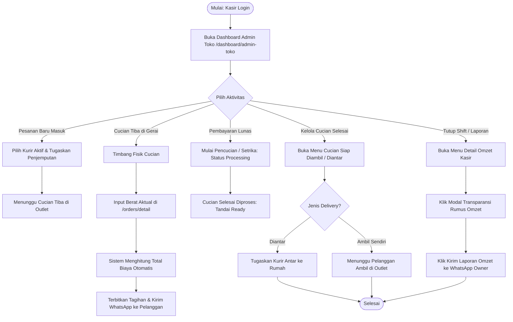

# ACTIVITY DIAGRAM: ADMIN TOKO (KASIR) FLOW

Diagram aktivitas ini menggambarkan kegiatan operasional harian **Admin Toko (Kasir)** dalam mengelola pesanan masuk, penimbangan berat, pemisahan pakaian siap antar, dan pembukuan kasir.

