# ACTIVITY DIAGRAM: CUSTOMER FLOW

Diagram aktivitas ini menggambarkan alur kerja pengguna dengan peran **Customer** mulai dari membuka platform, mencari toko, memesan laundry, melakukan pembayaran QRIS, hingga cucian diterima kembali.

```mermaid
flowchart TD
    Start([Mulai: Pelanggan Buka Web]) --> LoginCheck{Sudah Login?}
    LoginCheck -- Belum --> Login[Login Akun / Google OAuth / Register]
    Login --> Dashboard[Buka Dashboard Customer]
    LoginCheck -- Sudah --> Dashboard

    Dashboard --> Explore[Eksplorasi Katalog Toko Laundry]
    Explore --> DetailToko[Pilih Toko & Lihat Layanan Cuci]
    DetailToko --> OrderForm[Buka Form Pemesanan /orders/create]
    OrderForm --> SelectAddress[Pilih Alamat Penjemputan / Buat Alamat Baru]
    SelectAddress --> SelectService[Pilih Jenis Layanan & Estimasi Berat/Satuan]
    SelectService --> SubmitOrder[Klik Buat Pesanan]

    SubmitOrder --> OrderCreated[Pesanan Berstatus Pending]
    OrderCreated --> WaitingCourier[Menunggu Konfirmasi & Penugasan Kurir Toko]
    WaitingCourier --> CourierPickup[Kurir Menjemput Cucian di Rumah]
    CourierPickup --> ArriveStore[Cucian Tiba di Gerai Laundry]
    ArriveStore --> Weighed[Kasir Menimbang Berat & Invoice Diterbitkan]

    Weighed --> ReceiveInvoice[Pelanggan Menerima Notifikasi WhatsApp & In-App]
    ReceiveInvoice --> OpenPayment[Buka Halaman Pembayaran QRIS]
    OpenPayment --> ScanQRIS[Scan QRIS Dinamis & Selesaikan Transfer]
    ScanQRIS --> WebhookVerify{Verifikasi Webhook Lunas?}
    WebhookVerify -- Gagal/Tertunda --> OpenPayment
    WebhookVerify -- Berhasil --> PaidStatus[Status Pembayaran: Paid]

    PaidStatus --> InWash[Pakaian Dicuci & Disetrika oleh Outlet]
    InWash --> OrderReady[Status Cucian: Ready]
    OrderReady --> DeliveryChoice{Metode Pengambilan?}
    DeliveryChoice -- Diantar Kurir --> CourierDeliver[Kurir Mengantar ke Alamat Pelanggan]
    DeliveryChoice -- Ambil Sendiri --> PickupSelf[Pelanggan Mengambil di Gerai]
    CourierDeliver --> Delivered[Serah Terima Cucian: Status Delivered]
    PickupSelf --> Delivered

    Delivered --> End([Selesai])
```

