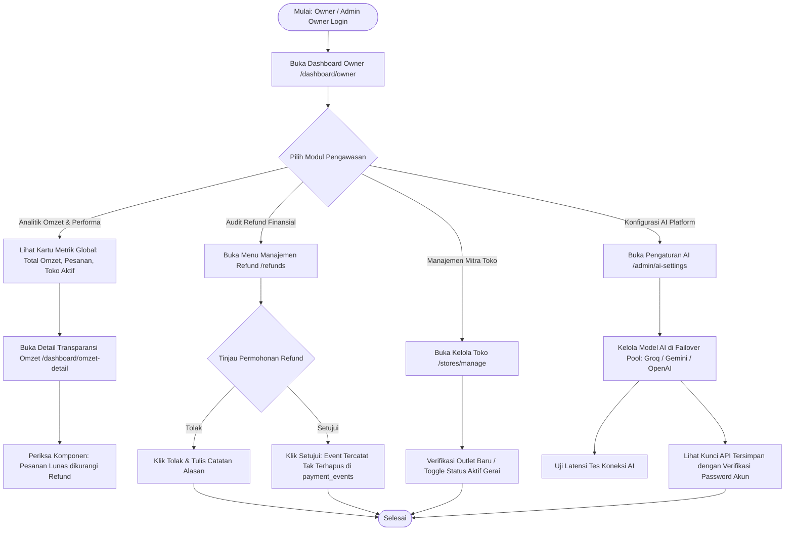

# ACTIVITY DIAGRAM: OWNER & ADMIN OWNER FLOW

Diagram aktivitas ini menggambarkan proses pengawasan eksekutif, audit keuangan, dan manajemen konfigurasi platform oleh **Owner** dan **Admin Owner**.

