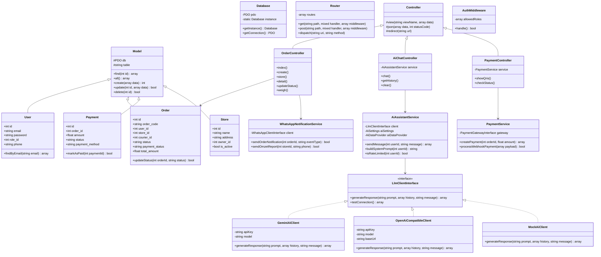

# CLASS DIAGRAM SISTEM LAUNDRYKU

Diagram kelas ini menyajikan struktur kelas objek utama, relasi pewarisan (*inheritance*), realisasi antarmuka (*interface implementation*), dan dependensi pada arsitektur Pure PHP MVC LaundryKu.

