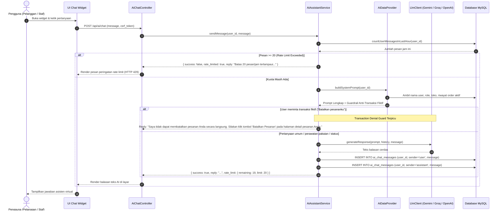

# SEQUENCE DIAGRAM: SMARTBOT AI ASSISTANT

Diagram sekuens ini menggambarkan alur pemrosesan pertanyaan pengguna pada modul AI, penerapan guardrail ketat (*Transaction Denial & Anti-Hallucination*), serta adapter LLM multi-model.

