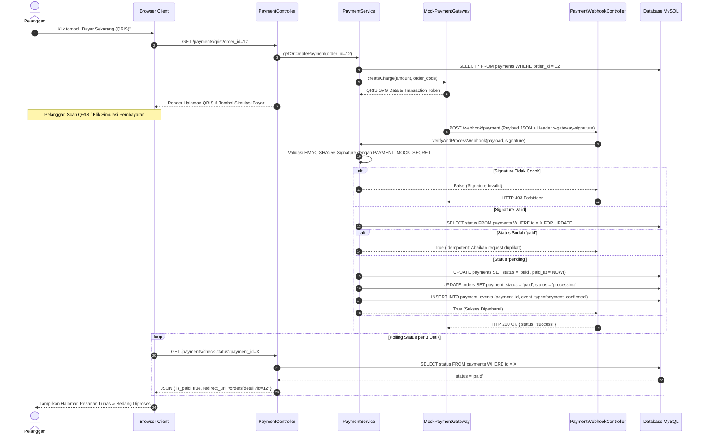

# SEQUENCE DIAGRAM: PAYMENT & WEBHOOK GATEWAY

Diagram sekuens ini menggambarkan interaksi teknis pembuatan QRIS, simulasi pembayaran, validasi HMAC signature webhook, dan pencatatan audit finansial.

