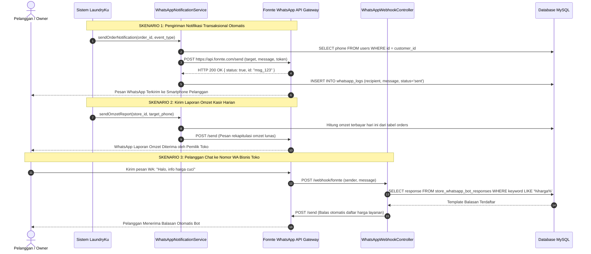

# SEQUENCE DIAGRAM: WHATSAPP NOTIFICATION & BOT WEBHOOK

Diagram sekuens ini menggambarkan pengiriman notifikasi transaksional otomatis, pelaporan omzet kasir harian ke WhatsApp pemilik toko, dan penanganan webhook pesan masuk bot.

