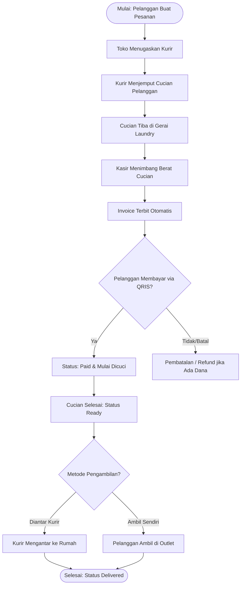

# PRODUCT REQUIREMENTS DOCUMENT (PRD)
## Sistem Informasi Marketplace Laundry Berbasis Web dengan Integrasi AI (LaundryKu)

---

### 1. Cover
- **Judul Proyek**: Pengembangan Platform Marketplace Laundry Berbasis Web Terintegrasi Multi-Model AI Assistant, Dynamic Payment QRIS, dan Live Tracking Kurir
- **Nama Produk**: LaundryKu (SmartLaundry Pro)
- **Dokumen**: Product Requirements Document (PRD)
- **Versi Dokumen**: 2.0 (Final Release UAS)
- **Mata Kuliah**: Rekayasa Perangkat Lunak (RPL)
- **Tahun Akademik**: 2026/2027
- **Institusi**: [UNIVERSITAS / INSTITUSI] — [PERLU DIISI]

---

### 2. Informasi Project
| Parameter | Keterangan |
|:---|:---|
| **Nama Aplikasi** | LaundryKu |
| **Tema** | Marketplace Laundry Berbasis Web dengan Integrasi AI |
| **Arsitektur Sistem** | Pure PHP MVC (PSR-4), MySQL PDO, Bootstrap 5.3, RESTful API |
| **Kelompok Pengembang** | [KELOMPOK] — [PERLU DIISI] |
| **Daftar Anggota** | 1. [NAMA MAHASISWA 1] / [NIM 1] — [PERLU DIISI]<br>2. [NAMA MAHASISWA 2] / [NIM 2] — [PERLU DIISI]<br>3. [NAMA MAHASISWA 3] / [NIM 3] — [PERLU DIISI] |
| **Kelas** | [KELAS] — [PERLU DIISI] |
| **Status Repositori** | Siap Uji & Pengumpulan UAS |

---

### 3. Latar Belakang
Layanan binatu (*laundry*) telah menjadi kebutuhan primer bagi masyarakat urban, pekerja kantoran, dan mahasiswa yang memiliki keterbatasan waktu. Meskipun permintaan tinggi, sebagian besar industri binatu skala UMKM di Indonesia masih menghadapi hambatan operasional:
1. **Pencatatan Konvensional**: Nota fisik seringkali hilang atau rusak, berujung pada perselisihan berat cucian dan jumlah tagihan.
2. **Ketiadaan Pelacakan Real-time**: Pelanggan tidak mengetahui posisi kurir penjemput atau tahapan pemrosesan pakaian mereka.
3. **Komunikasi Manual yang Membebani Staf**: Kasir harus menjawab pertanyaan repetitif via telepon/chat (seperti jam buka, tarif jenis pakaian tertentu, status pesanan, dan estimasi waktu).
4. **Isolasi Finansial Multi-Cabang**: Pemilik toko kesulitan memisahkan dan memantau pendapatan riil kasir per cabang secara transparan dan aman tanpa risiko kebocoran data antar-outlet.

Oleh karena itu, dikembangkanlah platform **LaundryKu**, sebuah marketplace binatu multi-tenant cerdas yang mengintegrasikan otomasi alur transaksi, notifikasi WhatsApp otomatis, pelacakan GPS kurir, dan asisten AI berbasis LLM dengan jaminan keamanan finansial dan proteksi data.

---

### 4. Identifikasi Masalah
1. Pelanggan kesulitan menemukan informasi harga dan layanan laundry terdekat secara komprehensif tanpa harus mendatangi gerai.
2. Proses penjemputan (*pickup*) pakaian sering mengalami miskomunikasi koordinat lokasi antara kurir dan pelanggan.
3. Ketidakpastian estimasi biaya sebelum penimbangan cucian di gerai laundry.
4. Beban operasional admin/kasir yang tinggi dalam mengonfirmasi pembayaran dan memberikan laporan progres cucian.
5. Ketiadaan asisten konsultasi perawatan pakaian (*fabric care*) yang siap sedia 24 jam untuk menjawab pertanyaan jenis bahan sensitif (kebaya, jas, sutra).
6. Potensi konflik transparansi omzet kasir harian akibat percampuran transaksi yang belum terbayar atau ter-refund.

---

### 5. Rumusan Masalah
1. Bagaimana merancang arsitektur web marketplace laundry yang mampu mengisolasi data transaksi antar-toko laundry secara ketat (*multi-tenancy store isolation*)?
2. Bagaimana mengimplementasikan *state machine* 12 status pesanan yang menghubungkan peran pelanggan, kasir, kurir, dan pemilik toko secara real-time?
3. Bagaimana mengintegrasikan asisten AI virtual berbasis Large Language Model (Google Gemini, GroqCloud, OpenAI) dengan *guardrail* ketat agar tidak mengarang data transaksi?
4. Bagaimana menyediakan mekanisme pembayaran digital QRIS dinamis dan notifikasi WhatsApp transaksional yang idempoten dan aman?

---

### 6. Tujuan
1. Membangun platform marketplace laundry berbasis web dengan arsitektur MVC yang modular, mudah dipelihara, dan handal.
2. Menyediakan 6 peran pengguna (*Role-Based Access Control*) dengan hak akses dan dasbor operasional yang terisolasi.
3. Menyediakan sistem penjemputan cucian dengan live tracking kurir berbasis Leaflet/OpenStreetMap dan kalkulasi jarak Haversine.
4. Menerapkan asisten virtual cerdas **SmartBot AI** dengan fitur multi-model pool dan proteksi kredensial enkripsi AES-256-GCM.
5. Menghadirkan transparansi pembukuan omzet kasir dengan kalkulasi otomatis selisih pembayaran lunas dan refund.

---

### 7. Manfaat
- **Bagi Pelanggan**: Kepastian penjemputan, transparansi harga per kilogram/satuan, kemudahan bayar via QRIS, dan akses konsultasi AI 24/7.
- **Bagi Pengelola Toko**: Digitalisasi nota timbangan, pembagian tugas kurir yang sistematis, pembukuan omzet harian otomatis, dan laporan instan ke WhatsApp.
- **Bagi Kurir**: Kepastian alamat pelanggan dengan panduan peta GPS dan kemudahan pengubahan status antar jemput dengan tombol sederhana.
- **Bagi Pemilik Platform**: Kemampuan pengawasan eksekutif terhadap performa seluruh mitra toko dan keandalan sistem berskala luas.

---

### 8. Target Pengguna
1. **Pelanggan Umum**: Individu atau keluarga yang membutuhkan jasa binatu reguler maupun ekspres.
2. **Kasir Toko (Admin Toko)**: Staf gerai yang bertanggung jawab atas penimbangan, penerimaan fisik cucian, dan pemrosesan laundry.
3. **Pemilik Toko (Owner Toko)**: Mitra pemilik usaha gerai laundry yang mengelola daftar layanan dan mengevaluasi omzet.
4. **Kurir Laundry**: Tenaga operasional lapangan yang menjemput dan mengantar pakaian.
5. **Admin Platform (Admin Owner)**: Tim operasional yang memverifikasi gerai dan memelihara parameter teknis.
6. **Pemilik Platform (Owner)**: Pimpinan pengelola platform marketplace laundry nasional.

---

### 9. Persona Pengguna

#### Persona 1: Customer
- **Nama**: Neila Barsha
- **Pekerjaan**: Karyawan Swasta (27 tahun)
- **Kebutuhan**: Membutuhkan jasa cuci setrika express karena jadwal kerja padat; ingin pakaian dijemput di kos dan diantar tepat waktu.
- **Pain Point**: Malas menelepon toko untuk menanyakan apakah cucian sudah selesai; khawatir pakaian berbahan sutra rusak jika dicuci sembarangan.
- **Peran di Sistem**: Melakukan booking pesanan, melacak posisi kurir, konsultasi perawatan pakaian via SmartBot AI, dan membayar via QRIS.

#### Persona 2: Admin Toko / Kasir
- **Nama**: Rina Melati
- **Pekerjaan**: Kasir di gerai CleanMaster Laundry Express
- **Kebutuhan**: Mencatat timbangan berat cucian secara cepat, memverifikasi pembayaran pelanggan, dan memisahkan cucian yang siap diambil atau diantar.
- **Pain Point**: Sering lupa mencatat nomor nota fisik; pusing menghitung manual setoran kasir di akhir shift kerja.
- **Peran di Sistem**: Input berat cucian, verifikasi invoice, klik status siap antar, dan mengirim laporan omzet harian ke WhatsApp pemilik toko.

#### Persona 3: Kurir
- **Nama**: Budi Santoso
- **Pekerjaan**: Kurir Penjemputan & Pengantaran Laundry
- **Kebutuhan**: Melihat daftar alamat penjemputan yang urut dan jelas di ponsel; mengabari sistem saat mulai jalan atau selesai antar.
- **Pain Point**: Sering tersesat mencari alamat pelanggan tanpa titik koordinat GPS yang akurat.
- **Peran di Sistem**: Toggle status dinas online, navigasi rute via peta Leaflet, update status pesanan menjadi *picked_up* dan *delivered*.

---

### 10. Deskripsi Produk
**LaundryKu** adalah platform web terintegrasi yang mendigitalisasi seluruh siklus bisnis binatu dari hulu ke hilir. Dibangun dengan pendekatan *object-oriented* murni pada PHP 8.1 dan database MySQL, LaundryKu mengedepankan keamanan data melalui session hardening, enkripsi simetris AES-256-GCM, validasi CSRF, dan RBAC server-side.

---

### 11. Scope (Batasan Sistem)
- Registrasi dan login multi-role (6 peran) serta Google OAuth 2.0.
- Manajemen multi-toko (katalog publik, penambahan toko, edit profil toko).
- Manajemen layanan cuci (kiloan, satuan, dry clean, express).
- Alur 12 status pesanan (*order state machine*).
- Kalkulator jarak matematis (Formula Haversine & Distance Matrix) dan live tracking polling kurir.
- Pembayaran via QRIS dinamis dan simulasi webhook gateway.
- Alur pengajuan dan persetujuan pengembalian dana (*refund*) dengan riwayat audit.
- Notifikasi lonceng in-app (polling 30 detik) dan notifikasi eksternal WhatsApp via Fonnte gateway.
- Asisten AI pintar multi-provider (Google Gemini, GroqCloud, OpenAI, OpenAI Compatible) dengan proteksi *transaction denial*, injeksi konteks dinamis, dan failover pool.
- Dasbor analitik spesifik per role dan modal transparansi omzet kasir.

---

### 12. Out of Scope (Di Luar Batasan Sistem)
- Mesin kasir fisik (hardware POS thermal printing atau timbangan Bluetooth otomatis).
- Pembayaran tunai otomatis via mesin setor tunai.
- Integrasi armada kurir pihak ketiga eksternal seperti GoSend API / GrabExpress API (menggunakan kurir internal mitra toko).
- Aplikasi mobile native Android/iOS (fokus sistem adalah web responsif mobile-friendly).

---

### 13. Aktor Sistem
Sesuai rancangan basis data pada tabel `roles`:
1. `customer`
2. `admin_toko`
3. `owner_toko`
4. `kurir`
5. `admin_owner`
6. `owner`

---

### 14. User Journey (Pelanggan)
```
Eksplorasi Katalog Toko -> Pilih Layanan -> Tentukan Titik Antar-Jemput -> Konfirmasi Pemesanan
-> Kurir Menjemput Pakaian -> Pakaian Tiba di Toko & Ditimbang -> Pelanggan Menerima Tagihan
-> Scan QRIS & Pembayaran Lunas -> Pakaian Dicuci & Selesai -> Kurir Mengantar Kembali -> Pesanan Diterima
```

---

### 15. User Flow
1. **Flow Pemesanan**: Pelanggan Login $\rightarrow$ Klik 'Pesan Sekarang' $\rightarrow$ Pilih Toko $\rightarrow$ Pilih Alamat $\rightarrow$ Pilih Layanan $\rightarrow$ Klik Submit $\rightarrow$ Status Pesanan menjadi `pending`.
2. **Flow Penjemputan**: Kurir menerima penugasan $\rightarrow$ Status `assigned_to_courier` $\rightarrow$ Kurir menuju lokasi (`courier_on_the_way`) $\rightarrow$ Cucian diambil (`picked_up`) $\rightarrow$ Tiba di gerai (`arrived_at_store`).
3. **Flow Timbangan & Bayar**: Kasir menimbang cucian $\rightarrow$ Input berat di `/orders/detail` $\rightarrow$ Status `weighed` $\rightarrow$ Invoice terbit (`waiting_payment`) $\rightarrow$ Pelanggan scan QRIS $\rightarrow$ Webhook verifikasi lunas (`paid`).
4. **Flow Pemrosesan & Antar**: Kasir klik proses cuci (`processing`) $\rightarrow$ Pakaian selesai (`ready`) $\rightarrow$ Kurir mengantar (`out_for_delivery`) $\rightarrow$ Serah terima pelanggan (`delivered`).

---

### 16. Business Process


---

### 17. Kebutuhan Fungsional (Functional Requirements)
- **FR-01**: Sistem harus menyediakan form registrasi dan login multi-role dengan hashing password BCRYPT.
- **FR-02**: Sistem harus mendukung login alternatif menggunakan Google OAuth 2.0.
- **FR-03**: Sistem harus membatasi akses URL dan tindakan berdasarkan role pengguna menggunakan middleware.
- **FR-04**: Sistem harus mengisolasi data transaksi antar-toko sehingga admin toko hanya dapat mengelola data miliknya.
- **FR-05**: Sistem harus memungkinkan pelanggan membuat pesanan laundry dengan pemilihan layanan dan alamat terpetakan.
- **FR-06**: Sistem harus mengelola transisi status pesanan melalui 12 siklus status yang terstruktur.
- **FR-07**: Sistem harus menghitung total biaya pesanan secara otomatis berdasarkan tarif layanan dan berat aktual.
- **FR-08**: Sistem harus menampilkan kode QRIS dinamis untuk pembayaran pesanan.
- **FR-09**: Sistem harus menerima dan memvalidasi webhook pembayaran dengan tanda tangan HMAC.
- **FR-10**: Sistem harus memungkinkan pengajuan dan persetujuan pengembalian dana (*refund*) dengan pencatatan audit.
- **FR-11**: Sistem harus menampilkan posisi kurir secara live pada peta Leaflet.js melalui polling AJAX.
- **FR-12**: Sistem harus mengirimkan notifikasi WhatsApp otomatis saat terjadi transisi status pesanan.
- **FR-13**: Sistem harus menyediakan widget chat asisten virtual AI untuk menjawab pertanyaan seputar perawatan pakaian dan status pesanan.
- **FR-14**: Sistem harus menerapkan *guardrail* ketat pada AI agar menolak melakukan transaksi fiktif.
- **FR-15**: Sistem harus menyediakan fitur multi-model pool bagi AI dengan enkripsi API key AES-256-GCM.
- **FR-16**: Sistem harus menyediakan dasbor khusus untuk masing-masing dari 6 role pengguna.
- **FR-17**: Sistem harus menyediakan laporan omzet kasir dengan rincian transparansi formula pendapatan.

---

### 18. Kebutuhan Non-Fungsional (Non-Functional Requirements)
- **NFR-Security**: Proteksi terhadap CSRF di semua form POST, pencegahan SQL Injection dengan PDO Prepared Statements, proteksi XSS dengan `htmlspecialchars`, dan enkripsi kredensial API key dengan AES-256-GCM.
- **NFR-Performance**: Waktu respons halaman rata-rata $\le 1.2$ detik pada server lokal; latensi respons AI $\le 3$ detik.
- **NFR-Reliability**: Sistem menangani kegagalan API eksternal (AI atau WhatsApp) secara *graceful* tanpa menimbulkan fatal crash HTTP 500.
- **NFR-Availability**: Layanan web dapat diakses 24 jam sehari dengan sistem backup database berkala.
- **NFR-Usability**: Desain antarmuka responsif berbasis Bootstrap 5.3 yang adaptif pada layar desktop maupun smartphone.

---

### 19. Daftar Fitur Lengkap
1. Multi-Role RBAC (Customer, Admin Toko, Owner Toko, Kurir, Admin Owner, Owner)
2. Google OAuth 2.0 Authentication
3. Store & Service Management
4. Customer Address Book & Geocoding Koordinat
5. 12-State Order Machine
6. Ready Delivery Separate Screen (Siap Diambil vs Siap Diantar)
7. Weight Input & Auto Billing Calculator
8. Dynamic Visual QRIS Payment
9. Webhook Signature Verification
10. Financial Refund Management & Event Audit Log
11. Courier GPS Live Tracking & Duty Switch
12. Distance Matrix & Haversine Distance Calculation
13. In-App Notification Bell dengan Polling 30 Detik
14. WhatsApp Gateway Transaksional (Fonnte) & Auto-Reply Bot
15. SmartBot AI Assistant Widget
16. Multi-Model AI Failover Pool (Gemini, Groq, OpenAI)
17. Password-Protected API Key Reveal dengan Rate Limiting
18. Live AI Health Check & Connection Latency Test
19. Dasbor Analitik Spesifik Per Role
20. Transparansi Omzet Kasir & Rincian Transaksi
21. Utilitas Backup Database Mandiri (`database/backup.php`)

---

### 20. Fitur AI (SmartBot Assistant)
- **Engine**: Mendukung Google Gemini REST API (`gemini-2.5-flash`), GroqCloud (`llama-3.3-70b-versatile`), OpenAI (`gpt-4o-mini`), dan Mock Client.
- **Transaction Denial Guard**: Asisten AI tidak dapat membatalkan pesanan atau memproses refund di chat; AI secara otomatis mengarahkan pelanggan ke tombol antarmuka resmi.
- **Dynamic Context Injection**: Prompt sistem secara otomatis membaca nama pelanggan, riwayat pesanan aktif, katalog harga resmi toko terkait, dan data operasional (khusus staf).
- **Anti-Hallucination Guard**: Staf yang bertanya omzet dijawab presisi dari angka database sistem tanpa spekulasi.
- **Rate Limit**: Pembatasan maksimal 20 pesan per pengguna per jam untuk mencegah eksploitasi kuota API.

---

### 21. Integrasi Eksternal
1. **Google AI Studio API / GroqCloud / OpenAI API**: LLM untuk SmartBot.
2. **Fonnte API Gateway**: Pengiriman pesan notifikasi WhatsApp.
3. **OpenStreetMap / Leaflet**: Peta geolokasi penjemputan dan rute kurir.
4. **Google Identity Services**: OAuth 2.0 Single Sign-On.

---

### 22. Keamanan (Security)
- Password disimpan dalam bentuk hash BCRYPT (`PASSWORD_DEFAULT`).
- Token CSRF unik per sesi yang divalidasi pada setiap request mutasi data (POST/PUT/DELETE).
- Kunci API pihak ketiga disimpan terenkripsi menggunakan AES-256-GCM dengan kunci master derivasi `APP_KEY`.
- Pelihatan API key tersimpan dilindungi autentikasi password akun login dan pembatasan maksimal 5 kali percobaan per 10 menit.
- Header HTTP keamanan: `Cache-Control: no-store, no-cache, must-revalidate` pada endpoint kredensial sensitif.

---

### 23. Risiko
- Ketergantungan pada konektivitas gateway WhatsApp pihak ketiga (Fonnte) yang sewaktu-waktu dapat mengalami kendala server.
- Batasan kuota harian atau perubahan kebijakan API pada penyedia LLM (Google AI Studio/Groq).
- Variasi akurasi sinyal GPS pada perangkat mobile kurir.

---

### 24. Mitigasi
- Penerapan pola *Interface & Adapter* (`WhatsAppClientInterface` dan `LlmClientInterface`) sehingga sistem dapat beralih ke penyedia alternatif (atau Mock Client saat pengujian lokal) tanpa mengubah kode pengendali utama.
- Fitur *Multi-Model Failover Pool* yang memungkinkan pergantian provider AI secara instan dengan satu klik.
- Mekanisme *retry* otomatis pada antrean notifikasi WhatsApp yang gagal kirim.

---

### 25. Acceptance Criteria
Sesuai dengan 18 kriteria penerimaan MVP pada berkas `ACCEPTANCE_CRITERIA.md`:
1. Autentikasi dan isolasi role berhasil 100%.
2. Pemesanan laundry berhasil mengkalkulasi harga sesuai berat dan jenis layanan.
3. Transisi 12 status pesanan terekam pada riwayat status.
4. Kurir dapat memperbarui posisi GPS dan status pesanan.
5. Pembayaran QRIS terverifikasi otomatis oleh webhook.
6. AI Assistant menjawab pertanyaan perawatan pakaian dan status pesanan tanpa membocorkan data rahasia.
7. Seluruh 27 berkas uji otomatis (*test suites*) dapat dieksekusi dengan hasil validasi penuh.
