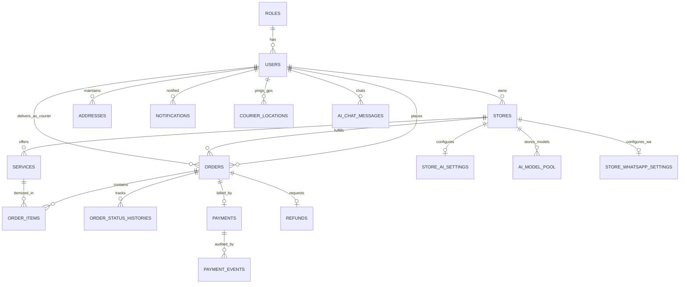
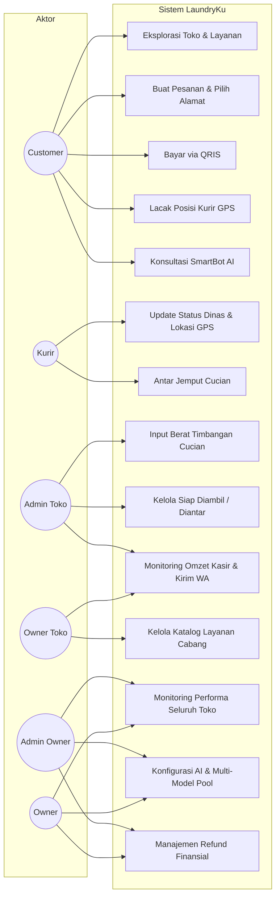
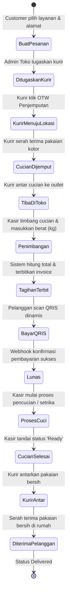
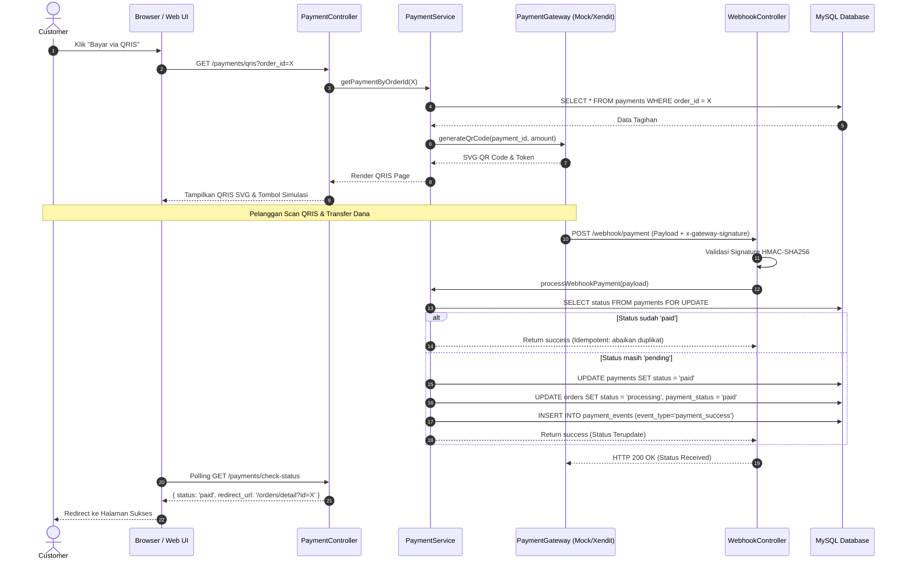
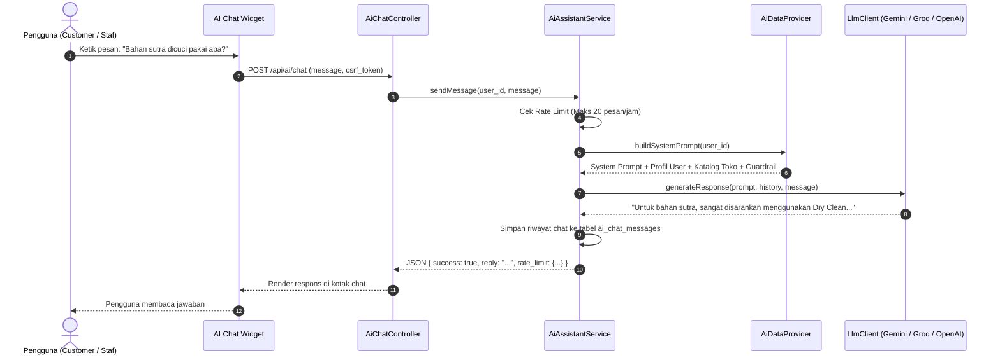
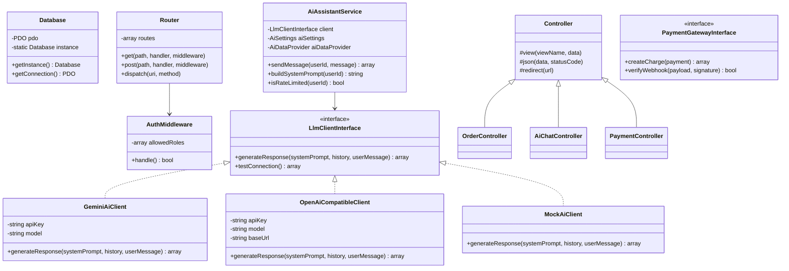

# SOFTWARE DESIGN DESCRIPTION (SDD)
## Sistem Informasi Marketplace Laundry Berbasis Web dengan Integrasi AI (LaundryKu)

---

### 1. Pendahuluan
Dokumen **Software Design Description (SDD)** ini menyajikan spesifikasi arsitektur teknis, desain komponen, skema basis data, dan pola perancangan perangkat lunak untuk sistem **LaundryKu**. Dokumen ini ditujukan sebagai panduan teknis rekayasa perangkat lunak, evaluasi pengujian, dan pemeliharaan sistem.

---

### 2. Tujuan Sistem
1. Menyediakan arsitektur berbasis Pure MVC (Model-View-Controller) yang modular dan independen dari dependensi framework monolitik besar.
2. Mengimplementasikan enkapsulasi data melalui *Object-Oriented Programming (OOP)* dan pola *Interface Segregation*.
3. Menjamin integritas transaksi data keuangan dan pesanan melalui *Atomic Database Transactions* (PDO Transaction).
4. Menyediakan antarmuka pemrograman aplikasi (RESTful API) untuk integrasi modul pembayaran, notifikasi WhatsApp, dan asisten kecerdasan buatan (AI).

---

### 3. Arsitektur Sistem (High-Level Architecture)
Sistem mengadopsi arsitektur **3-Tier Web Architecture**:
1. **Presentation Tier (Client/Browser)**: HTML5, CSS3, JavaScript modern (ES6+), Bootstrap 5.3, FontAwesome 6, dan Leaflet.js.
2. **Application Tier (Web & App Server)**: Apache HTTP Server dengan PHP 8.1 Runtime, Router kustom, Controller, Middleware RBAC, dan Service Layer.
3. **Data Tier (Database Server)**: MySQL 8.0 / MariaDB 10.4 dengan InnoDB storage engine, foreign key constraints, dan indeks teroptimasi.

```
+-----------------------------------------------------------------------------------+
|                            CLIENT TIER (Web Browser)                              |
|  - Customer UI (Catalog, Order, Tracking)   - Admin/Store Dashboard               |
|  - Courier Mobile Web Peta GPS              - SmartBot AI Chatbot Widget          |
+------------------------------------------+----------------------------------------+
                                           | HTTP/HTTPS (REST, AJAX Polling)
+------------------------------------------v----------------------------------------+
|                      APPLICATION TIER (PHP 8.1 Pure MVC)                          |
|  [Router] ---> [AuthMiddleware (RBAC)] ---> [Controllers]                        |
|                                                    |                              |
|                         +--------------------------+--------------------------+  |
|                         |                          |                          |  |
|                  [Service Layer]             [Models / PDO]            [Views]   |
|                  - AiAssistantService        - User, Store, Order     - Blade/PHP|
|                  - PaymentService            - Payment, Refund        - Layouts  |
|                  - WhatsAppNotificationSvc   - Notification, Address  - Partials |
+-------------------------+--------------------------+------------------------------+
                          |                          | PDO MySQL
+-------------------------v----------+     +---------v------------------------------+
|         EXTERNAL SERVICES          |     |           DATA TIER (MySQL)            |
|  - Google Gemini / Groq / OpenAI   |     |  - marketplace_laundry                 |
|  - Fonnte WhatsApp API Gateway     |     |  - 25 Relational Tables (InnoDB)       |
|  - Leaflet / OpenStreetMap Tiles   |     |  - Transactions & Foreign Keys         |
+------------------------------------+     +----------------------------------------+
```

---

### 4. Teknologi yang Digunakan
| Komponen | Spesifikasi / Alat |
|:---|:---|
| **Bahasa Pemrograman** | PHP 8.1 / 8.2 (Strict Typing, Native OOP) |
| **Framework Arsitektur** | Custom Pure PHP MVC dengan PSR-4 Standard Autoloading |
| **Database Management** | MySQL 8.0 / MariaDB 10.4+ (PDO Engine) |
| **Styling & UI Library** | Bootstrap 5.3, FontAwesome 6.4, Inter Fonts |
| **Mapping & Geocoding** | Leaflet.js v1.9, OpenStreetMap Tile Engine |
| **AI LLM API** | Google Gemini REST API v1beta, GroqCloud API, OpenAI API |
| **Messaging Gateway** | Fonnte WhatsApp API Gateway & Webhook |
| **Testing Harness** | Native PHP Test Runner (27 Test Suites, 980+ assertions) |

---

### 5. Struktur Project
```text
rpl/
├── app/
│   ├── Controllers/       # Pengendali rute HTTP & logika presentasi
│   ├── Core/              # Router, Database Singleton, Controller & Model Base
│   ├── Helpers/           # Auth, Session, Csrf, Logger, Validator, Env, Config
│   ├── Models/            # Active Record & query mapping entity
│   ├── Services/          # Lapisan logika bisnis independen (AI, WA, Payment, Finance)
│   └── Views/             # Template presentasi HTML/PHP
├── config/                # File konfigurasi modular (app, database, ai, whatsapp, payment)
├── database/              # schema.sql, modular migrations, dan backup utility
├── docs/                  # Dokumentasi teknis PRD, SDD, Pengujian, UI/UX, Diagram
├── public/                # Document root (index.php, css, js, images)
├── storage/               # Logs (app.log) dan database backups (.sql)
├── tests/                 # Automated test runner dan test suites
├── .env.example           # Berkas konfigurasi template
└── .gitignore             # Aturan proteksi upload file sensitif
```

---

### 6. Arsitektur Aplikasi (MVC Request-Response Cycle)
1. **Entry Point**: Seluruh request HTTP diarahkan ke `public/index.php` melalui aturan rewrite `.htaccess`.
2. **Environment & Autoload**: `Env::load()` memuat file `.env`, diikuti inisialisasi PSR-4 autoloader.
3. **Routing**: `Router::dispatch()` mencocokkan URI dan metode HTTP dengan daftar rute.
4. **Middleware Execution**: `AuthMiddleware` memeriksa status sesi login dan memvalidasi kecocokan role pengguna terhadap daftar role yang diizinkan (RBAC). Jika tidak berhak, dikembalikan respons HTTP 403.
5. **Controller**: Controller mengambil request, memanggil model atau service bisnis terkait, dan menyiapkan data.
6. **View Rendering**: `Controller::view()` menyematkan data ke dalam template layout utama (`layouts/main.php`) dan mengirimkan HTML kembali ke browser.

---

### 7. Modul Sistem
1. **Modul Auth & Profil**: Manajemen sesi login, registrasi pelanggan, Google OAuth 2.0, verifikasi OTP WhatsApp, dan manajemen alamat.
2. **Modul Multi-Tenancy Store**: Manajemen data outlet laundry, isolasi data pesanan, dan konfigurasi profil gerai.
3. **Modul Transaksi & Order State Machine**: Pemesanan cucian, penimbangan kasir, penetapan kurir, dan pelacakan status 12 tahap.
4. **Modul Pembayaran & QRIS**: Pembuatan QRIS dinamis, webhook konfirmasi pembayaran, dan verifikasi tanda tangan HMAC-SHA256.
5. **Modul Refund & Audit Finansial**: Pengajuan pengembalian dana, persetujuan admin/owner, dan pencatatan event audit transaksi tak terhapus.
6. **Modul Kurir & Tracking GPS**: Toggle status dinas online/offline, polling posisi GPS setiap 10 detik, dan visualisasi rute peta Leaflet.
7. **Modul WhatsApp Gateway**: Pengiriman notifikasi transaksional otomatis, pelaporan omzet ke nomor pemilik toko, dan webhook auto-reply bot.
8. **Modul SmartBot AI**: Asisten konsultasi cerdas dengan injeksi prompt dinamis, anti-mengarang omzet, multi-model pool, dan enkripsi API key.
9. **Modul Laporan & Transparansi Omzet**: Visualisasi kartu metrik operasional, rincian omzet kasir terbayar, dan modal transparansi kalkulasi matematika omzet.

---

### 8. Desain Basis Data (Database Design)
Database sistem bernama `marketplace_laundry` yang terdiri dari 25 tabel relational:

| No | Nama Tabel | Deskripsi Entitas | Primary Key | Foreign Key |
|:--:|:---|:---|:---|:---|
| 1 | `roles` | Daftar 6 peran pengguna | `id` | - |
| 2 | `users` | Akun pengguna seluruh role | `id` | `role_id` $\rightarrow$ `roles.id` |
| 3 | `stores` | Outlet gerai laundry mitra | `id` | `owner_id` $\rightarrow$ `users.id` |
| 4 | `services` | Katalog jenis layanan cuci per toko | `id` | `store_id` $\rightarrow$ `stores.id` |
| 5 | `addresses` | Alamat penjemputan & koordinat GPS | `id` | `user_id` $\rightarrow$ `users.id` |
| 6 | `orders` | Master data transaksi pesanan | `id` | `user_id`, `store_id`, `courier_id` |
| 7 | `order_items` | Rincian layanan dalam pesanan | `id` | `order_id`, `service_id` |
| 8 | `order_status_histories` | Riwayat transisi 12 status pesanan | `id` | `order_id`, `changed_by` |
| 9 | `payments` | Data tagihan dan metode pembayaran | `id` | `order_id` $\rightarrow$ `orders.id` |
| 10 | `payment_events` | Audit trail immutable event transaksi | `id` | `payment_id` $\rightarrow$ `payments.id` |
| 11 | `payment_logs` | Log teknis komunikasi gateway | `id` | - |
| 12 | `refunds` | Permohonan pengembalian dana pesanan | `id` | `order_id`, `user_id` |
| 13 | `courier_locations` | Koordinat GPS live kurir | `id` | `courier_id` $\rightarrow$ `users.id` |
| 14 | `notifications` | Notifikasi in-app lonceng pengguna | `id` | `user_id` $\rightarrow$ `users.id` |
| 15 | `ai_chat_messages` | Riwayat percakapan user dengan SmartBot | `id` | `user_id` $\rightarrow$ `users.id` |
| 16 | `ai_settings` | Konfigurasi platform AI global | `id` / `setting_key` | - |
| 17 | `ai_settings_audit` | Audit log pengubahan parameter AI | `id` | `user_id` $\rightarrow$ `users.id` |
| 18 | `ai_model_pool` | Koleksi model AI failover terenkripsi | `id` | `store_id` $\rightarrow$ `stores.id` |
| 19 | `ai_key_reveal_attempts`| Rate limit percobaan buka kunci API | `id` | `user_id` $\rightarrow$ `users.id` |
| 20 | `store_ai_settings` | Pengaturan & API key AI khusus toko | `store_id` | `store_id` $\rightarrow$ `stores.id` |
| 21 | `whatsapp_settings` | Konfigurasi platform WhatsApp gateway | `id` | - |
| 22 | `whatsapp_logs` | Riwayat pesan WhatsApp terkirim | `id` | `store_id` $\rightarrow$ `stores.id` |
| 23 | `store_whatsapp_settings` | Kredensial WhatsApp gateway per toko | `store_id` | `store_id` $\rightarrow$ `stores.id` |
| 24 | `store_whatsapp_bot_settings`| Pengaturan bot WhatsApp per toko | `store_id` | `store_id` $\rightarrow$ `stores.id` |
| 25 | `store_whatsapp_bot_responses`| Template kata kunci balasan bot WA | `id` | `store_id` $\rightarrow$ `stores.id` |

---

### 9. Entity Relationship Diagram (ERD)


---

### 10. Use Case Diagram


---

### 11. Activity Diagram (Siklus Pemesanan Cucian)


---

### 12. Sequence Diagram (Pembayaran QRIS & Webhook Idempoten)


---

### 13. Sequence Diagram (Konsultasi SmartBot AI)


---

### 14. Class Diagram


---

### 15. Authentication Design
1. **Password Authentication**:
   - Algoritma hashing: `PASSWORD_BCRYPT` via `password_hash($password, PASSWORD_DEFAULT)`.
   - Verifikasi hash: `password_verify($password, $hash)`.
   - Proteksi sesi: Regenerasi session ID (`session_regenerate_id(true)`) saat login berhasil untuk mencegah *session fixation attack*.
2. **Google OAuth 2.0**:
   - Menggunakan alur *Authorization Code Flow*.
   - User dialihkan ke Google Consent Screen via `/auth/google`.
   - Callback diproses di `/auth/google/callback`, menukarkan kode autorisasi dengan access token Google API v3, membaca email dan profil, kemudian membuat atau mencocokkan user di database.

---

### 16. Authorization / RBAC Matrix
Ditegakkan secara deklaratif pada file rute `public/index.php` melalui kelas `AuthMiddleware`:

| Endpoint URL | Customer | Kurir | Admin Toko | Owner Toko | Admin Owner | Owner |
|:---|:---:|:---:|:---:|:---:|:---:|:---:|
| `/dashboard/customer` | Allowed | Denied | Denied | Denied | Denied | Denied |
| `/dashboard/kurir` | Denied | Allowed | Denied | Denied | Denied | Denied |
| `/dashboard/admin-toko` | Denied | Denied | Allowed | Denied | Denied | Denied |
| `/dashboard/owner-toko` | Denied | Denied | Denied | Allowed | Denied | Denied |
| `/dashboard/admin-owner` | Denied | Denied | Denied | Denied | Allowed | Denied |
| `/dashboard/owner` | Denied | Denied | Denied | Denied | Denied | Allowed |
| `/dashboard/omzet-detail`| Denied | Denied | Allowed | Allowed | Allowed | Allowed |
| `/orders/create` | Allowed | Denied | Denied | Denied | Denied | Denied |
| `/orders/ready-delivery` | Denied | Denied | Allowed | Allowed | Denied | Denied |
| `/courier/toggle-duty` | Denied | Allowed | Denied | Denied | Denied | Denied |
| `/admin/ai-settings` | Denied | Denied | Denied | Denied | Allowed | Allowed |
| `/admin/store-ai-settings`| Denied | Denied | Allowed | Allowed | Denied | Denied |
| `/admin/whatsapp` | Denied | Denied | Allowed | Denied | Allowed | Allowed |
| `/stores/manage` | Denied | Denied | Denied | Denied | Allowed | Allowed |
| `/users` | Denied | Denied | Denied | Denied | Allowed | Allowed |

---

### 17. Desain API (REST Endpoints)

#### 1. AI Assistant Chat
- **URL**: `POST /api/ai/chat`
- **Headers**: `Content-Type: application/x-www-form-urlencoded`, `X-CSRF-TOKEN`
- **Request Body**: `message=Tanya+layanan+cuci`
- **Response Success (200 OK)**:
  ```json
  {
    "success": true,
    "reply": "Layanan cuci express kami selesai dalam 24 jam dengan tarif...",
    "error": null,
    "rate_limit": { "remaining": 19, "limit": 20 }
  }
  ```
- **Response Rate Limited (429 Too Many Requests)**:
  ```json
  {
    "success": false,
    "rate_limited": true,
    "reply": "Anda telah mencapai batas maksimal (20 pesan per jam)...",
    "error": "Rate limit exceeded.",
    "rate_limit": { "remaining": 0, "limit": 20 }
  }
  ```

#### 2. Payment Status Polling
- **URL**: `GET /payments/check-status?payment_id={id}`
- **Response (200 OK)**:
  ```json
  {
    "status": "paid",
    "is_paid": true,
    "redirect_url": "http://localhost/rpl/public/orders/detail?id=1"
  }
  ```

#### 3. Kurir Live Location Polling
- **URL**: `GET /courier/location?order_id={id}`
- **Response (200 OK)**:
  ```json
  {
    "status": "success",
    "latitude": -6.2088,
    "longitude": 106.8456,
    "updated_at": "2026-11-16 12:00:00"
  }
  ```

---

### 18. Integrasi WhatsApp Gateway
- **Provider**: Fonnte Gateway REST API.
- **Header Autentikasi**: `Authorization: {API_TOKEN}`.
- **Payload Notifikasi Transaksional**:
  ```json
  {
    "target": "08123456789",
    "message": "*[LaundryKu]* Halo Budi, cucian Anda (#ORD-001) telah selesai ditimbang seberat 3.5 kg. Total tagihan: Rp28.000. Silakan bayar melalui link berikut...",
    "countryCode": "62"
  }
  ```
- **Inbound Webhook**: URL `/webhook/fonnte` memproses pesan masuk pelanggan secara asinkronus, mencocokkan kata kunci balasan bot, dan mengembalikan jawaban otomatis.

---

### 19. Integrasi AI & Multi-Model Pool
- Sistem menggunakan arsitektur antarmuka `LlmClientInterface` dengan 3 adapter utama:
  1. `GeminiAiClient`: Menghubungi endpoint `https://generativelanguage.googleapis.com/v1beta/models/{model}:generateContent`.
  2. `OpenAiCompatibleClient`: Menghubungi REST endpoint OpenAI atau GroqCloud (`https://api.groq.com/openai/v1/chat/completions`).
  3. `MockAiClient`: Menghasilkan jawaban deterministik cerdas untuk kebutuhan testing offline dan CI/CD.
- **Failover Pool**: Tabel `ai_model_pool` memungkinkan penyimpanan multi-kredensial dan pergantian engine aktif secara instan dari dashboard.

---

### 20. Integrasi Payment & QRIS Dinamis
- **SVG QRIS Generator**: Membuat visual QR code mandiri berbasis string spesifikasi standar QRIS nasional.
- **Webhook Verifier**: Menghitung signature `hash_hmac('sha256', $rawBody, $secretKey)` dan membandingkannya dengan header `x-gateway-signature`.

---

### 21. Tracking Kurir & Algoritma Jarak (Distance Calculator)
- Menggunakan formula trigonometri bola bumi (**Haversine Formula**):
  $$d = 2r \arcsin \left( \sqrt{\sin^2\left(\frac{\Delta \phi}{2}\right) + \cos(\phi_1)\cos(\phi_2)\sin^2\left(\frac{\Delta \lambda}{2}\right)} \right)$$
  dengan $r = 6.371\text{ km}$.
- Hasil perhitungan jarak digunakan untuk mengkalkulasi estimasi ongkos kirim dan estimasi waktu tempuh kurir menuju titik pelanggan.

---

### 22. Desain Keamanan (Security Hardening)
1. **CSRF Protection**: Token acak `bin2hex(random_bytes(32))` diverifikasi menggunakan `hash_equals()`.
2. **Kredensial Terenkripsi**: API key dienkripsi menggunakan algoritma `aes-256-gcm` dengan initialization vector (IV) 12-byte acak dan authentication tag 16-byte.
3. **Data Isolation**: Query SQL yang memuat `store_id` dipaksa terikat ke sesi login pengguna untuk mencegah eskalasi hak akses horizontal (*IDOR*).
4. **Anti-Leak Header**: Endpoint pembuka kunci API menyertakan header proteksi:
   `Cache-Control: no-store, no-cache, must-revalidate, max-age=0`.

---

### 23. Penanganan Kesalahan (Error Handling & Logging)
- **Error Handler Global**: `set_exception_handler` dan `set_error_handler` terpasang di `public/index.php`.
- **Mode Produksi (`APP_DEBUG=false`)**: Detail stack trace disembunyikan dari pengguna; browser hanya menampilkan template error ramah `app/Views/errors/500.php` atau `404.php`.
- **Structured Logging**: Seluruh kegagalan sistem, pengecualian tidak tertangkap, dan log audit ditulis ke berkas `storage/logs/app.log` dengan level `ERROR`, `WARNING`, atau `INFO`.

---

### 24. Panduan Deployment
1. Konfigurasi virtual host Apache dengan document root mengarah ke direktori `public/`.
2. Pastikan modul Apache `mod_rewrite` diaktifkan.
3. Berikan izin baca-tulis (*read-write permission*) pada direktori `storage/logs/` dan `storage/backups/`.
4. Atur `APP_ENV=production` dan `APP_DEBUG=false` pada berkas `.env`.

---

### 25. Konfigurasi Environment (`.env`)
Berkas `.env` memuat variabel krusial:
- `APP_NAME`, `APP_ENV`, `APP_DEBUG`, `APP_URL`, `APP_KEY`
- `DB_HOST`, `DB_PORT`, `DB_DATABASE`, `DB_USERNAME`, `DB_PASSWORD`
- `AI_PROVIDER`, `GEMINI_API_KEY`, `AI_MODEL`, `AI_RATE_LIMIT_PER_HOUR`
- `WHATSAPP_ENABLED`, `WHATSAPP_PROVIDER`, `WHATSAPP_API_TOKEN`
- `PAYMENT_GATEWAY`, `PAYMENT_MOCK_SECRET`
- `GOOGLE_CLIENT_ID`, `GOOGLE_CLIENT_SECRET`, `GOOGLE_REDIRECT_URI`
