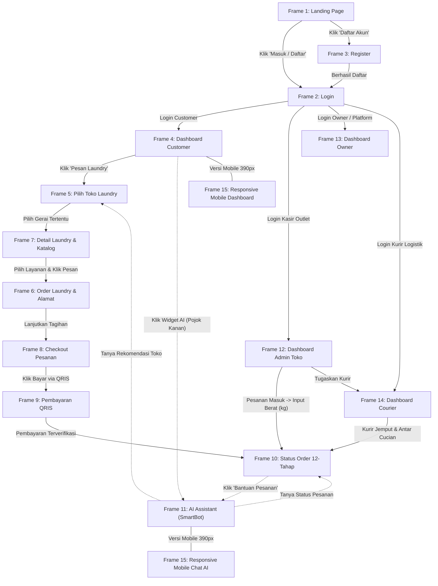

# DOKUMENTASI SPESIFIKASI UI/UX & PANDUAN FIGMA PROJECT
## LaundryKu (SmartLaundry Pro / WashMart)
### Marketplace Laundry Berbasis Web dengan Integrasi Multi-Model AI

Dokumentasi ini disusun khusus sebagai **acuan presisi perancangan UI/UX di Figma** (*Figma-Ready Design Specification*), diselaraskan secara akurat dengan arsitektur kode sumber riil pada direktori `app/Views/` di sistem `c:\xampp\htdocs\rpl`.

---

# 🎨 1. DESIGN SYSTEM (SISTEM DESAIN GLOBAL)

Sistem desain menggunakan filosofi **Modern, Simple, and User-Friendly** dengan pendekatan *Clean Modern SaaS*, sudut membulat (*soft rounded corners*), serta kontras visual tinggi yang nyaman di mata pengguna (*accessible* WCAG AA).

```
┌──────────────────────────────────────────────────────────────────────────────────┐
│                             WashMart / LaundryKu UI/UX                            │
│                 Modern • Simple • User Friendly | Figma Ready Design             │
└──────────────────────────────────────────────────────────────────────────────────┘
```

---

### 1.1 Color Palette (Palet Warna Resmi Figma)

| Token Warna | Nilai HEX | Peran & Penggunaan Utama di Figma |
|:---|:---:|:---|
| **Primary Blue** | `#2563EB` | Warna primer identitas aplikasi, Tombol CTA Utama, Link aktif, Fokus border form, Tab terpilih. |
| **Secondary Cyan** | `#06B6D4` | Aksen sekunder, banner teknologi AI, badge fitur unggulan, status pelacakan kurir. |
| **Success Green** | `#22C55E` | Konfirmasi pembayaran QRIS lunas, pesanan selesai, indikator kurir aktif/online. |
| **Warning Orange** | `#F59E0B` | Status pesanan baru, menunggu penjemputan, batas waktu pembayaran, alert penimbangan. |
| **Error / Danger Red** | `#EF4444` | Pembatalan pesanan, status gagal/kedaluwarsa, tombol logout, alert validasi error. |
| **Neutral Gray** | `#6B7280` | Teks sekunder, label pembantu, placeholder input, border kartu, ikon non-aktif. |
| **Dark Slate (Heading)**| `#1E293B` | Teks judul utama (*headings* H1-H3), latar sidebar dashboard admin, label bernilai tegas. |
| **Surface White** | `#FFFFFF` | Latar belakang kartu (*card*), modal popup, input field, dropdown panel. |
| **Canvas Background** | `#F8FAFC` | Latar belakang dasar halaman (*body canvas background*), area non-konten. |
| **Primary Light (Subtle)**| `#EFF6FF` | Background badge primary, hover state baris tabel, highlight item keranjang. |

---

### 1.2 Typography System (Tipografi Standar Figma)

* **Font Utama:** `Poppins` (Alternatif Fallback: `Inter`, `Segoe UI`, `sans-serif`)
* **Font Monospace:** `JetBrains Mono` / `SF Mono` (Untuk Nomor Invoice `#INV-XXXXX`, Kode QRIS, GPS Lat/Lng)

| Level Teks | Ukuran Font | Weight | Line Height | Letter Spacing | Penggunaan di Halaman |
|:---|:---:|:---:|:---:|:---:|:---|
| **H1 (Display)** | `32px` | Bold (700) | `40px` (1.25) | `-0.5px` | Judul hero banner, headline utama login/register. |
| **H2 (Page Title)** | `24px` | SemiBold (600) | `32px` (1.33) | `-0.25px` | Judul halaman dashboard, judul section utama. |
| **H3 (Section Title)**| `20px` | SemiBold (600) | `28px` (1.4) | `0px` | Header kartu stat, sub-section form, judul modal. |
| **Body (Regular)** | `16px` | Regular (400) | `24px` (1.5) | `0px` | Paragraf deskripsi, input form teks, isi chat bubble. |
| **Body Medium** | `16px` | Medium (500) | `24px` (1.5) | `0px` | Label form, teks tombol CTA, item menu sidebar. |
| **Caption (Small)** | `14px` | Regular (400) | `20px` (1.43) | `0px` | Helper text, waktu notifikasi, rating review, footer. |
| **Badge / Micro** | `12px` | SemiBold (600) | `16px` (1.33) | `+0.5px` | Label pill status pesanan, tag diskon, counter kupon. |

---

### 1.3 UI Components Library

#### A. Buttons (Komponen Tombol)
1. **Primary Button:**
   - Auto Layout: Padding Horizontal `24px`, Vertical `12px`, Corner Radius `10px` (atau `999px` Pill).
   - Fill: Solid `#2563EB`, Text: `#FFFFFF`, Poppins 16px Medium, Shadow: `0px 4px 12px rgba(37, 99, 235, 0.25)`.
   - State: Default, Hover (`#1D4ED8`), Pressed/Active (`#1E40AF`), Disabled (`#93C5FD`).
2. **Secondary Button:**
   - Auto Layout: Padding Horizontal `20px`, Vertical `12px`, Corner Radius `10px`.
   - Fill: `#EFF6FF` atau Transparent dengan Stroke 1.5px `#2563EB`, Text: `#2563EB`, Poppins 16px Medium.
3. **Success Button:**
   - Auto Layout: Padding Horizontal `20px`, Vertical `12px`, Corner Radius `10px`.
   - Fill: Solid `#22C55E`, Text: `#FFFFFF`, Poppins 16px Medium, Shadow: `0px 4px 12px rgba(34, 197, 94, 0.25)`.
4. **Icon Button:**
   - Ukuran Frame: `40px x 40px`, Corner Radius `50%` (Circle) atau `8px`.
   - Fill: `#F3F4F6`, Icon 20px `#4B5563`. Hover: Fill `#E5E7EB`.

#### B. Input Fields (Komponen Formulir)
- Ukuran Frame Input: Lebar fluid / fixed `100%`, Tinggi `48px`, Corner Radius `10px`.
- Fill: `#FFFFFF`, Stroke: 1px `#E2E8F0`, Text: `#1E293B`, Placeholder: `#94A3B8`.
- Left Icon Slot: Frame `20px x 20px` (Ikon Envelope, Lock, Search, Store).
- Right Action Slot: Tombol mata intip sandi (`eye`/`eye-slash`) atau tombol clear text.
- Focus State: Stroke 2px `#2563EB`, Drop Shadow `0px 0px 0px 4px rgba(37, 99, 235, 0.15)`.

#### C. Status Badges & Pills
- Auto Layout: Padding Horizontal `12px`, Vertical `6px`, Corner Radius `999px` (Full Pill).
- Teks: Poppins 12px SemiBold, Uppercase/Capitalize.
  - **Pesanan Baru:** Fill `#FEF3C7`, Text `#D97706` (Border 1px `#FDE68A`).
  - **Diproses (Cuci/Setrika):** Fill `#DBEAFE`, Text `#2563EB` (Border 1px `#BFDBFE`).
  - **Dikirim (Kurir):** Fill `#E0E7FF`, Text `#4F46E5` (Border 1px `#C7D2FE`).
  - **Selesai / Lunas:** Fill `#DCFCE7`, Text `#16A34A` (Border 1px `#BBF7D0`).
  - **Dibatalkan / Expired:** Fill `#FEE2E2`, Text `#DC2626` (Border 1px `#FECACA`).

#### D. Cards & Containers
- Auto Layout: Padding `24px`, Corner Radius `16px`.
- Fill: `#FFFFFF`, Stroke: 1px `#F1F5F9`, Drop Shadow: `0px 4px 20px rgba(0, 0, 0, 0.05)`.
- Header Card: Judul H3 SemiBold 20px, Subtitle Caption 14px, Divider Line 1px `#F1F5F9`.

#### E. Navigation Icons (24px Grid)
- Ikon Vektor Monoline: `Home`, `Order / Basket`, `Chat AI (Bot)`, `Courier (Truck)`, `User Profile`, `Settings`.

---

# 📱 2. SPESIFIKASI HALAMAN (FRAMES 1 S/D 15)

---

## 2.1 Frame 1: Landing Page (Halaman Utama Publik)
*Implementasi kode sumber:* `app/Views/home/index.php` & `app/Views/layouts/navbar.php`

* **Ukuran Frame Figma:**
  * Desktop: `1440px x 1024px` (Scrollable Height: `1800px`)
  * Mobile: `390px x 844px`
* **Layout:**
  * **Top Navbar:** Fixed Header `1440px x 72px`, Container Width `1200px`. Logo di kiri, Menu di tengah, Tombol CTA Login di kanan.
  * **Hero Section:** 2-Kolom Grid. Kolom kiri (Width 640px) teks promosi & tombol aksi; Kolom kanan (Width 480px) ilustrasi mesin cuci modern dan kartu showcase fitur.
  * **Section "Mengapa WashMart?":** Grid 3-Kolom fitur keunggulan (AI Assistant, Pengiriman Cepat, Harga Transparan).
  * **Section "Layanan Laundry Populer":** Grid 4-Kolom kartu layanan (Cuci Komplit, Cuci Kering, Setrika Saja, Bed Cover/Sepatu).
  * **Section "Mitra Toko Terdekat":** Grid 3-Kolom kartu toko laundry terlaris dengan rating.
  * **Footer:** Background Dark `#0F172A`, Copyright, Social Links, Navigasi Bantuan.
* **Komponen:**
  * Badge Promo: `"✨ Platform Marketplace Laundry Masa Depan"` (Fill `#E0F2FE`, Text `#0369A1`).
  * Headline Hero: `"Laundry Lebih Mudah dengan Teknologi AI"` (H1 36px Bold, Fill `#1E293B`).
  * Sub-headline: `"Pesan laundry, lacak pesanan real-time, dan dapatkan rekomendasi perawatan pakaian cerdas."`
  * CTA Buttons: Tombol `"Mulai Sekarang"` (Primary Blue) + `"Cari Toko Terdekat"` (Outline).
  * Kartu Keunggulan: Icon circle background pastel, Title H3 18px Bold, Paragraph 14px Regular.
* **Warna:** Background Canvas `#FFFFFF` & `#F8FAFC`, Hero Accent Gradient (`rgba(37,99,235,0.06)`).
* **Typography:** Poppins H1 (36px), H2 (28px), H3 (18px), Body (16px), Caption (14px).
* **Button:** `.btn-primary` (Pesan Sekarang), `.btn-outline` (Pelajari Layanan).
* **Input:** Search bar toko di hero section (Height `52px`, Pill Radius `999px`, Icon Search).
* **Card:** Feature Cards (Radius 16px, Padding 24px, Elevation Light).
* **Navigasi:** Links ke `#beranda`, `#layanan`, `#cari-toko`, `#tentang-kami`, tombol `Masuk / Daftar`.

---

## 2.2 Frame 2: Login
*Implementasi kode sumber:* `app/Views/auth/login.php`

* **Ukuran Frame Figma:**
  * Desktop: `1440px x 900px` (Center Modal Card: `460px x 620px`)
  * Mobile: `390px x 844px`
* **Layout:**
  * Split screen atau Center Container Card beralas kanvas netral `#F8FAFC`.
  * Kartu login elevated di tengah layar dengan logo di atas, heading selamat datang, form inputs, tombol aksi, pemisah OAuth, dan link pendaftaran.
* **Komponen:**
  * Logo Icon Box: Circle `64px x 64px`, Background `#EFF6FF`, Icon Hanger/Bubble `#2563EB`.
  * Title: `"Selamat Datang!"` (H2 24px Bold), Subtitle: `"Masuk untuk melanjutkan pesanan Anda"` (Caption 14px).
  * Social Login Button: Tombol Google OAuth 2.0 (`"Masuk dengan Google"`, White background, border `#E2E8F0`, Icon Google).
  * Divider Line: Separator `"ATAU LOGIN DENGAN EMAIL"`.
  * Form Elements: Input Email, Input Password dengan toggle icon mata.
  * Remember Me & Forgot Password: Row horizontal (Checkbox `"Ingat saya"` & Link `"Lupa password?"`).
* **Warna:** Primary `#2563EB`, Background Card `#FFFFFF`, Border `#E2E8F0`, Text `#1E293B`.
* **Typography:** H2 24px Bold, Label 14px Medium, Input Text 15px Regular.
* **Button:**
  * Tombol Utama: `"Masuk ke Akun"` (Primary Blue, Full Width, Height `48px`, Corner Radius `10px`).
  * Tombol Google: Height `48px`, White Pill Card with Google G-Logo.
* **Input:**
  * Email Field: Height `48px`, Left Icon Envelope, Placeholder `nama@email.com`.
  * Password Field: Height `48px`, Left Icon Lock, Right Icon Eye Toggle, Placeholder `••••••••`.
* **Card:** Modal/Card Container `460px`, Padding `36px`, Radius `20px`, Shadow `0px 10px 30px rgba(0,0,0,0.08)`.
* **Navigasi:** Link footer `"Belum punya akun? Daftar sekarang"` (mengarahkan ke Frame 3: Register).

---

## 2.3 Frame 3: Register
*Implementasi kode sumber:* `app/Views/auth/login.php` (Tab Register) & `app/Controllers/AuthController.php`

* **Ukuran Frame Figma:**
  * Desktop: `1440px x 960px` (Center Modal Card: `480px x 720px`)
  * Mobile: `390px x 844px`
* **Layout:**
  * Serasi dengan frame Login, container terpusat dengan form registrasi pelanggan baru.
* **Komponen:**
  * Header: Title `"Daftar Akun Baru"`, Subtitle `"Nikmati kemudahan laundry online terpercaya"`.
  * Form Input:
    1. Nama Lengkap (Text Input)
    2. Nomor WhatsApp / Handphone (Input dengan prefix `+62`)
    3. Alamat Email (Email Input)
    4. Password (Password Input dengan indikator kekuatan kata sandi)
    5. Konfirmasi Password (Password Input)
  * Checkbox Persetujuan: `"Saya menyetujui Syarat & Ketentuan Layanan LaundryKu"`.
  * Submit Button: `"Buat Akun Sekarang"`.
* **Warna:** Primary `#2563EB`, Success `#22C55E` (Checkmark validasi), Background `#F8FAFC`.
* **Typography:** H2 24px Bold, Form Label 14px Medium, Helper 12px Regular.
* **Button:** Full Width Primary Button Height `48px`, Tombol Google Register.
* **Input:** 5 Input Fields (Height `46px`, Radius `10px`, Border 1px `#E2E8F0`).
* **Card:** Registration Card Container `480px`, Padding `36px`, Radius `20px`.
* **Navigasi:** Link `"Sudah punya akun? Masuk di sini"` (kembali ke Frame 2: Login).

---

## 2.4 Frame 4: Dashboard Customer
*Implementasi kode sumber:* `app/Views/dashboard/customer.php` & `app/Views/layouts/sidebar.php`

* **Ukuran Frame Figma:**
  * Desktop: `1440px x 960px`
  * Mobile: `390px x 844px`
* **Layout:**
  * **Sidebar Kiri (Width 260px):** Logo, Nav Items (Dashboard, Pesanan Saya, Riwayat, Chat AI, Profil, Logout).
  * **Top Header (Height 70px):** Search bar mini, Notifikasi Bell Badge, Avatar & Nama Customer.
  * **Konten Utama (Width 1140px, Padding 32px):**
    * Top Welcome Banner: `"Halo, Budi Santoso! 👋"` dengan ilustrasi cucian bersih.
    * 4 Kartu Metrik Ringkasan:
      1. Pesanan Aktif (Value: `2`, Icon: Washing Machine, Color: `#2563EB`)
      2. Total Pesanan Selesai (Value: `12`, Icon: Check Circle, Color: `#22C55E`)
      3. Saldo Kupon / Diskon (Value: `Rp 25.000`, Icon: Tag, Color: `#F59E0B`)
      4. Rating Diberikan (Value: `4.9 ★`, Icon: Star, Color: `#06B6D4`)
    * Section "Pesanan Terbaru": Tabel / Card List pesanan aktif beserta badge status real-time.
    * Tombol Cepat: Floating Action Button (FAB) SmartBot AI di pojok kanan bawah.
* **Komponen:**
  * Stat Cards Grid (4 Kolom pada desktop, 2x2 pada mobile).
  * Table / List Item: Kolom Kode Pesanan (`#INV-00124`), Nama Toko (`Laundry Express`), Tanggal, Total Tagihan, Badge Status (`Diproses`), Tombol Detail.
* **Warna:** Sidebar Background `#FFFFFF` (atau Dark `#1E293B`), Canvas `#F8FAFC`, Accent `#2563EB`.
* **Typography:** H2 26px Bold, Stat Value 28px Bold, Stat Label 13px Medium.
* **Button:** CTA Button `"Pesan Laundry Baru"` (Primary Blue, Icon Plus), Tombol `"Lihat Semua Pesanan"`.
* **Input:** Quick Search Invoice di Top Bar.
* **Card:** 4 Stat Metric Cards (Padding `20px`, Radius `14px`, Border 1px `#F1F5F9`).
* **Navigasi:** Navigasi ke Halaman Pilih Toko, Detail Pesanan, dan Floating Chatbot AI.

---

## 2.5 Frame 5: Pilih Toko Laundry (Marketplace Catalog)
*Implementasi kode sumber:* `app/Views/stores/index.php`

* **Ukuran Frame Figma:**
  * Desktop: `1440px x 960px`
  * Mobile: `390px x 844px`
* **Layout:**
  * Header Page: Title `"Pilih Toko Laundry"` dengan pencarian terpadu.
  * Filter Bar: Kategori Chip/Pills horizontal (`Semua`, `Terdekat (< 2 km)`, `Rating Tertinggi (4.5+)`, `Layanan Express`).
  * Main Content Grid: 3-Kolom Toko Laundry Cards.
* **Komponen:**
  * Search Bar: Width `100%`, Max Width `640px`, Height `48px`, Placeholder `"Cari nama toko laundry atau area..."`.
  * Store Card Components:
    * Image Thumbnail Gerai Laundry (`Height 160px`, Radius Top `14px`).
    * Badges Toko: Status Buka (`Buka`), Jarak GPS (`1.2 km dari Anda`).
    * Info Gerai: Nama Toko (H3 18px Bold), Alamat Ringkas, Rating Bintang (`★ 4.8 (1.2k ulasan)`).
    * Tag Layanan Tersedia: `Cuci Kiloan`, `Dry Clean`, `Express 3 Jam`.
    * Action Button: `"Pilih Toko Ini"` (Button Primary Blue).
* **Warna:** Accent Green untuk Badge `Buka` (`#22C55E`), Accent Yellow untuk Bintang (`#F59E0B`).
* **Typography:** H2 24px Bold, Store Name 18px Bold, Distance Text 13px Regular.
* **Button:** Pill Filter Buttons, Card CTA Button `"Pilih Toko"`.
* **Input:** Form Search dengan Clear Button.
* **Card:** Store Catalog Card (Width `360px`, Radius `16px`, Elevation Light).
* **Navigasi:** Klik kartu toko mengarahkan ke Frame 7: Detail Laundry & Katalog Layanan.

---

## 2.6 Frame 6: Order Laundry (Form Pemesanan & Alamat GPS)
*Implementasi kode sumber:* `app/Views/orders/create.php`

* **Ukuran Frame Figma:**
  * Desktop: `1440px x 960px` (Form Container Width: `840px`)
  * Mobile: `390px x 844px`
* **Layout:**
  * Single Column Form Stepper terpusat dengan 3 langkah jelas:
    1. *Pilih Toko & Jenis Layanan*
    2. *Estimasi Berat & Catatan Khusus*
    3. *Alamat Penjemputan & Pinpoint GPS Peta*
* **Komponen:**
  * Dropdown Toko Mitra: Menampilkan outlet yang dipilih.
  * Layanan Radio Selector: Pilihan layanan (Reguler 2 hari, Express 1 hari, Super Express 4 jam).
  * Weight Input Group: Input angka berat dengan stepper tombol `[-]` dan `[+]` serta satuan `kg`.
  * Address Selector Box: Pilihan alamat tersimpan pelanggan atau input alamat baru.
  * Map Widget (Leaflet/OSM): Peta interaktif ukuran `100% x 220px` dengan draggable marker penjemputan.
  * Special Note Textarea: `"Misal: Tolong pisahkan pakaian putih dan pakaian luntur"`.
* **Warna:** Primary Blue border pada pilihan aktif, Background abu-abu muda form `#F8FAFC`.
* **Typography:** Form Step Title 18px SemiBold, Form Label 14px Medium, Unit Badge 14px Bold.
* **Button:** Tombol `"Lanjutkan ke Ringkasan"` (Primary Blue), Tombol `"Batal"`.
* **Input:** Select Store Dropdown, Number Stepper Input, Textarea Catatan.
* **Card:** Container Card putih beralas shadow halus (Radius `18px`, Padding `32px`).
* **Navigasi:** Mengarahkan ke Frame 8: Checkout & Pembayaran.

---

## 2.7 Frame 7: Detail Laundry (Profil Outlet & Katalog)
*Implementasi kode sumber:* `app/Views/stores/show.php`

* **Ukuran Frame Figma:**
  * Desktop: `1440px x 1024px`
  * Mobile: `390px x 844px`
* **Layout:**
  * **Top Store Banner:** Cover photo toko `1440px x 240px` dengan profil avatar gerai di sudut kiri bawah.
  * **Store Info Bar:** Nama Toko, Alamat Lengkap, Jam Buka (08:00 - 21:00), Rating & Jumlah Ulasan.
  * **Content Tabs:** `Katalog Layanan`, `Ulasan Pelanggan`, `Informasi Outlet`.
  * **Service Catalog Grid:** Kartu-kartu varian layanan cuci per kilogram dan per potong.
* **Komponen:**
  * Service Item Card:
    * Ikon Layanan (Shirt, Iron, Sparkles).
    * Nama Layanan (Contoh: `"Cuci Kiloan Reguler (Cuci + Kering + Lipat)"`).
    * Estimasi Waktu Pengerjaan (Contoh: `"2 Hari Kerja"`).
    * Harga (Contoh: `"Rp 8.000 / kg"`).
    * Tombol `"Pesan Layanan"`.
  * Review Section: Ringkasan bintang review, baris ulasan dari customer lain disertai rating bintang.
* **Warna:** Secondary Blue Accent, Card Background White.
* **Typography:** Store Title 28px Bold, Service Price 20px Bold Blue.
* **Button:** Tombol Pesan Langsung di tiap kartu layanan.
* **Input:** Filter pencarian layanan dalam toko.
* **Card:** Service Item Card (Border 1px `#E2E8F0`, Radius `12px`, Hover Border Primary).
* **Navigasi:** Tombol kembali ke Katalog Toko dan tombol lanjut ke Form Pemesanan.

---

## 2.8 Frame 8: Checkout (Ringkasan Tagihan & Voucher)
*Implementasi kode sumber:* `app/Views/orders/create.php` & `app/Controllers/OrderController.php`

* **Ukuran Frame Figma:**
  * Desktop: `1440px x 900px` (2-Kolom: 720px Rincian + 420px Ringkasan Biaya)
  * Mobile: `390px x 844px`
* **Layout:**
  * **Kolom Kiri:** Rincian Item Pakaian, Alamat Penjemputan & Pengantaran, Pilihan Waktu Penjemputan.
  * **Kolom Kanan:** Kartu Ringkasan Pembayaran (*Payment Summary Card*), Form Input Kupon Diskon, Pilihan Metode Pembayaran (QRIS Otomatis).
* **Komponen:**
  * Order Summary Row:
    * Subtotal Layanan: `Rp 40.000` (5 kg x Rp 8.000)
    * Biaya Penjemputan Kurir: `Rp 5.000`
    * Diskon Kupon: `- Rp 10.000`
    * Total Tagihan: `Rp 35.000` (Besar & Tebal)
  * Voucher Box: Input field kode voucher dengan tombol `"Terapkan"`.
  * Payment Method Radio: Pilihan `QRIS (BCA, Mandiri, GoPay, OVO, ShopeePay, DANA)`.
* **Warna:** Highlight Total Biaya `#2563EB`, Diskon Voucher Green `#22C55E`.
* **Typography:** Total Amount 24px Bold, Line Item 15px Regular, Voucher Text 14px Medium.
* **Button:** Tombol Utama `"Bayar Sekarang via QRIS"` (Primary Blue, Full Width, Icon QRCode).
* **Input:** Input field kode kupon diskon.
* **Card:** Order Review Card & Summary Sticky Card (Radius `16px`).
* **Navigasi:** Submit form langsung membuat order dan membuka Frame 9: Pembayaran QRIS.

---

## 2.9 Frame 9: Pembayaran / QRIS (Standar Resmi GPN)
*Implementasi kode sumber:* `app/Views/payments/qris.php`

* **Ukuran Frame Figma:**
  * Desktop: `1440px x 900px` (Center Stand Card: `420px x 680px`)
  * Mobile: `390px x 844px`
* **Layout:**
  * Card QRIS Stand Display resmi beralas kanvas netral `#F8FAFC`.
  * Header standar QRIS merah-putih, area kode QR dinamis di tengah, countdown timer, rincian nominal, panduan scan, dan tombol simulasi/verifikasi pembayaran.
* **Komponen:**
  * **Header Brand QRIS:** Logo resmi QRIS dengan label *"PEMBAYARAN DIGITAL INDONESIA"* dan logo GPN.
  * **Merchant Info:** Nama Outlet Laundry (misal: `"CleanMaster Express"`), National Merchant ID (NMID).
  * **QR Code Box:** Frame putih `240px x 240px`, Vektor SVG QR Code dinamis dengan logo QRIS di tengah.
  * **Nominal Tagihan:** Teks besar `Rp 35.000` (H1 28px Bold).
  * **Countdown Timer:** Badge Warning `"Selesaikan pembayaran dalam: 14:59"` (Timer mundur live).
  * **Panduan 4 Langkah:**
    1. Buka aplikasi m-Banking atau e-Wallet favorit Anda (BCA, GoPay, OVO, DANA, dll).
    2. Pilih menu **Scan QR / Bayar**.
    3. Arahkan kamera ponsel ke kode QRIS di atas.
    4. Periksa nama merchant dan konfirmasi pembayaran.
  * **Simulasi & Cek Status:** Tombol `"Cek Status Pembayaran"` dan tombol `"Bayar Sekarang (Simulasi)"` untuk pengujian lokal.
* **Warna:** QRIS Red Header `#E11D48` & `#DC2626`, Background Putih, Text Dark `#1E293B`.
* **Typography:** QRIS Header 18px Bold Black, Nominal Rp 28px Bold, Panduan 13px Regular.
* **Button:**
  * Primary Button: `"Cek Status Pembayaran"` (Primary Blue, Height `44px`).
  * Secondary Simulation Button: `"Bayar Sekarang (Simulasi)"` (Success Green).
* **Input:** Tidak ada (layar display transaksi).
* **Card:** QRIS Stand Card (Width `420px`, Radius `20px`, Border 1px `#E2E8F0`, Elevation Medium).
* **Navigasi:** Saat status terverifikasi lunas, otomatis dialihkan ke Frame 10: Status Order.

---

## 2.10 Frame 10: Status Order (12-Status Progress Tracker)
*Implementasi kode sumber:* `app/Views/orders/detail.php`

* **Ukuran Frame Figma:**
  * Desktop: `1440px x 960px`
  * Mobile: `390px x 844px`
* **Layout:**
  * **Top Order Bar:** Nomor Invoice `#INV-00124`, Waktu Order, Badge Status Aktif (`Dalam Pengantaran`).
  * **Kolom Kiri (Width 680px):**
    * **Vertical Progress Stepper:** 12 Titik Tahapan Status Pesanan riil sistem:
      1. `Pesanan Dibuat` (Checkmark Hijau)
      2. `Kurir Ditugaskan` (Checkmark Hijau)
      3. `Cucian Dijemput Kurir` (Checkmark Hijau)
      4. `Tiba di Toko Laundry` (Checkmark Hijau)
      5. `Penimbangan Cucian Selesai (Berat: 5.2 kg)` (Checkmark Hijau)
      6. `Sedang Dicuci (Washing)` (Checkmark Hijau)
      7. `Sedang Dikeringkan (Drying)` (Checkmark Hijau)
      8. `Sedang Disetrika (Ironing)` (Checkmark Hijau)
      9. `Siap Diantar Kurir` (Checkmark Hijau)
      10. `Dalam Pengantaran (Out for Delivery)` (Pulsing Blue Active Node)
      11. `Terkirim ke Pelanggan (Delivered)` (Gray Upcoming Node)
      12. `Selesai & Direview` (Gray Upcoming Node)
  * **Kolom Kanan (Width 440px):**
    * Widget Kurir Penjemput/Pengantar: Foto avatar kurir, Nama Kurir, Nomor WhatsApp aktif kurir, Plat motor, dan tombol chat WA.
    * Rincian Berat & Tagihan Final: Rincian berat riil hasil timbangan kasir.
    * Bantuan Pintar: Banner AI Assistant `"Ada kendala dengan cucian Anda? Chat SmartBot Sekarang"`.
* **Komponen:**
  * Vertical Stepper: Garis timeline vertical tebal 2px, Lingkaran status node 28px dengan ikon checkmark / pulsing dot.
  * Courier Profile Card: Avatar 54px circle, WhatsApp click-to-chat button.
* **Warna:** Node Selesai `#22C55E`, Node Berjalan `#2563EB`, Node Mendatang `#CBD5E1`.
* **Typography:** Stepper Title 15px SemiBold, Stepper Timestamp 12px Regular, Invoice Badge 14px Monospace.
* **Button:** Tombol `"Hubungi Kurir via WhatsApp"` (Green `#22C55E`), Tombol `"Beri Ulasan / Komplain"`.
* **Input:** Field ulasan bintang (1-5) dan review text saat pesanan selesai.
* **Card:** Stepper Container Card (Radius `16px`, Padding `28px`).
* **Navigasi:** Navigasi kembali ke Dashboard Customer atau membuka Widget AI Assistant.

---

## 2.11 Frame 11: AI Assistant (SmartBot Floating Widget)
*Implementasi kode sumber:* `app/Views/partials/ai_chat_widget.php`

* **Ukuran Frame Figma:**
  * Desktop Floating Panel: `380px x 540px` (Anchor: Pojok Kanan Bawah `right: 24px, bottom: 92px`)
  * Floating Trigger Button: Circle `58px x 58px` (Icon Bot/Sparkles, Gradient Indigo-Purple)
  * Mobile Fullscreen View: `390px x 844px`
* **Layout:**
  * **Header Widget (Height 64px):** Gradient Blue/Indigo, Bot Avatar dengan lampu status online hijau, Title `"SmartBot AI Assistant"`, Subtitle `"Online • Siap Membantu 24/7"`, Tombol Minimize/Close.
  * **Message History Container (Height 380px, Scrollable):** Area gelembung percakapan (*chat bubbles*).
  * **Quick Suggestion Chips (Horizontal Scroll):** Saran cepat pertanyaan umum pengguna.
  * **Chat Input Area (Height 68px, Bottom Pinned):** Input text multiline, Tombol Kirim panah pesawat kertas.
* **Komponen:**
  * Bot Greeting Bubble: Pesan pembuka otomatis:
    > *"Halo! 👋 Saya SmartBot, asisten AI LaundryKu. Ada yang bisa saya bantu? Misalnya: rekomendasi layanan, estimasi biaya, atau cek status pesanan Anda."*
  * Quick Prompt Chips:
    - Chip 1: `"🔍 Rekomendasi laundry terdekat"`
    - Chip 2: `"📦 Cek status pesanan #INV-00124"`
    - Chip 3: `"💡 Tips mencuci pakaian sutra & wol"`
  * User Chat Bubble: Background Primary Blue `#2563EB`, Text White, Align Right, Corner Radius `16px 16px 4px 16px`.
  * Bot Chat Bubble: Background Soft Gray `#F1F5F9`, Text Slate `#1E293B`, Align Left, Corner Radius `16px 16px 16px 4px`, Logo SmartBot mini di sisi kiri.
* **Warna:** Gradient Header `linear-gradient(135deg, #2563EB 0%, #4F46E5 100%)`, Online Dot `#22C55E`.
* **Typography:** Header Title 16px Bold White, Bubble Text 14px Regular, Suggestion Chip 12px Medium.
* **Button:** Tombol Send (Circle 36px, Fill `#2563EB`, Icon Paper Plane White), Suggestion Chips (Pill Border `#E2E8F0`).
* **Input:** Form Input Chat (Corner Radius `20px`, Height `40px`, Placeholder `"Ketik pertanyaan Anda..."`).
* **Card:** Floating Panel Card (Radius `18px`, Shadow `0px 16px 40px rgba(0,0,0,0.16)`).
* **Navigasi:** Dapat dipanggil dari semua halaman di seluruh role aplikasi.

---

## 2.12 Frame 12: Dashboard Admin Toko (Kasir Outlet)
*Implementasi kode sumber:* `app/Views/dashboard/admin_toko.php` & `app/Views/orders/index.php`

* **Ukuran Frame Figma:**
  * Desktop: `1440px x 960px`
  * Mobile: `390px x 844px`
* **Layout:**
  * **Sidebar Kiri (Dark Slate `#1E293B`, Width 260px):** Logo LaundryKu Toko, Menu (Dashboard, Pesanan Masuk, Penimbangan, Update Status, Siap Diantar, Chatbot Toko, Logout).
  * **Top Header:** Indikator Outlet (misal: `"CleanMaster Laundry Express"`), Toggle Buka/Tutup Toko, Profil Kasir.
  * **Konten Utama:**
    * 4 Stat Cards Operasional:
      1. Pesanan Baru Masuk (`8 Pesanan`, Warning Orange)
      2. Sedang Dicuci & Disetrika (`14 Pesanan`, Primary Blue)
      3. Siap Diantar (`6 Pesanan`, Info Cyan)
      4. Omzet Kasir Hari Ini (`Rp 1.450.000`, Success Green)
    * Quick Action Bar: Filter status pesanan cepat (*All, Perlu Timbang, Proses Cuci, Siap Antar*).
    * Tabel Master Pesanan Outlet: Kolom Checkbox, Invoice, Pelanggan, Layanan, Berat (kg), Status, Tombol Aksi.
* **Komponen:**
  * Modal Input Timbangan Cucian (`#modalTimbang`): Input berat riil kg, input jumlah potong pakaian, tombol simpan & terbitkan tagihan.
  * Modal Penugasan Kurir (`#modalAssignKurir`): Dropdown daftar kurir standby terdekat.
* **Warna:** Dark Navy Sidebar `#0F172A`, Accent Blue `#2563EB`, Background `#F8FAFC`.
* **Typography:** H2 24px Bold, Table Header 13px SemiBold Uppercase, Table Cell 14px Regular.
* **Button:** Action Button `"Timbang"` (Warning), `"Update Status"` (Primary), `"Panggil Kurir"` (Info).
* **Input:** Filter Search Invoice, Input Form Timbangan (kg) dengan step desimal `0.1`.
* **Card:** Stat Metric Cards & Data Table Card (Radius `14px`, White).
* **Navigasi:** Navigasi ke Halaman Penimbangan, Konfigurasi Chatbot Toko, dan Detail Omzet.

---

## 2.13 Frame 13: Dashboard Owner (Owner Toko & Platform)
*Implementasi kode sumber:* `app/Views/dashboard/owner_toko.php`, `app/Views/dashboard/owner.php`, & `app/Views/admin/ai_settings/index.php`

* **Ukuran Frame Figma:**
  * Desktop: `1440px x 1024px`
* **Layout:**
  * **Executive Top Bar:** Filter Rentang Tanggal Laporan (*Hari Ini, 7 Hari Terakhir, Bulan Ini, Tahun Ini*), Tombol Unduh Laporan PDF / Excel, Tombol `"Kirim Rekap ke WhatsApp"`.
  * **Metric Overview (4 Stat Cards Besar):**
    1. Total Mitra Toko Aktif (`24 Outlet`)
    2. Total Pesanan Selesai (`12.540 Transaksi`)
    3. Total Pengguna Terdaftar (`8.720 Akun`)
    4. Total Omzet Bruto (`Rp 125.500.000`)
  * **Grafik Visual Interaktif (2 Kolom):**
    * Kolom Kiri: Tren Pendapatan & Omzet Mingguan (Line Chart / Bar Chart Biru-Cyan).
    * Kolom Kanan: Peringkat Gerai Toko Berkinerja Terbaik (*Top Performing Outlets*).
  * **Panel Pengaturan AI Multi-Model:**
    * Konfigurasi Provider (Google Gemini / GroqCloud / OpenAI).
    * Kunci API Terenkripsi dengan Tombol Mata Reveal Kunci (Proteksi verifikasi password).
    * Model Failover Pool List.
* **Komponen:**
  * Line Chart Component (Canvas grafik pendapatan dengan tooltip nominal).
  * Ranked List Card: Daftar 5 cabang terlaris beserta progress bar pencapaian target.
  * AI Model Switcher Card: Badge provider aktif, radio button pilihan model, tombol tes latensi.
* **Warna:** Brand Blue `#2563EB`, Chart Gradient Cyan-Blue, Background `#F8FAFC`.
* **Typography:** Big Metric Display 32px Bold, Chart Legend 13px Medium.
* **Button:** Tombol `"Unduh Laporan"`, Tombol `"Kirim Rekap WA"`, Tombol `"Tes Koneksi AI"`.
* **Input:** Datepicker Range Selector, Modal Password Input untuk lihat API key.
* **Card:** Chart Container Card, Top Outlet Card, AI Settings Panel Card.
* **Navigasi:** Akses ke Manajemen Mitra Toko, Kelola Akun Kasir, dan Pengaturan Sistem.

---

## 2.14 Frame 14: Dashboard Courier (Jasa Antar / Kurir)
*Implementasi kode sumber:* `app/Views/dashboard/kurir.php`

* **Ukuran Frame Figma:**
  * Mobile Layout (Prioritas Kurir): `390px x 844px`
  * Tablet / Desktop Layout: `1440px x 900px`
* **Layout:**
  * **Header Status Dinas:** Toggle Switch besar: `"STATUS: DINAS ONLINE"` (Hijau) / `"OFFLINE"` (Abu-abu).
  * **Tab Penugasan:** 2 Tab Pilihan: `Tugas Penjemputan (Pickup)` dan `Tugas Pengantaran (Delivery)`.
  * **Peta Rute Interaktif (Leaflet OSM):** Tampilan peta real-time dengan rute jalur jalan dari lokasi kurir ke titik rumah pelanggan.
  * **Kartu Tugas Aktif (Order Task Card):**
    * Nomor Pesanan: `#INV-00124`
    * Nama Pelanggan: Budi Santoso (Tombol Panggil WA)
    * Alamat Penjemputan / Antar: Jl. Melati No. 12 (Jarak 1.4 km)
    * Estimasi Berat / Paket: 5 kg Cucian Reguler
    * Tombol Aksi Lapangan: `"Mulai OTW Penjemputan"`, `"Cucian Telah Diambil"`, `"Unggah Bukti Serah Terima"`.
* **Komponen:**
  * Toggle Switch Dinas (Lebar 56px, Tinggi 28px).
  * Map Card dengan Pinpoint Kurir (Motorcycle Icon) dan Pinpoint Rumah (House Icon).
  * Camera Upload Input: Tombol kamera untuk foto serah terima pakaian di tempat.
* **Warna:** Online Green `#22C55E`, Routing Blue `#2563EB`, Action Warning Orange `#F59E0B`.
* **Typography:** Status Badge 14px Bold, Customer Name 18px Bold, Address 14px Regular.
* **Button:** Tombol Aksi Utama Full-Width Height `52px` (Mudah ditekan saat di motor).
* **Input:** File Input Kamera / Unggah Foto Bukti.
* **Card:** Task Item Card dengan border status berwarna.
* **Navigasi:** Tab Pickup vs Delivery dan tombol navigasi langsung ke Google Maps / Waze.

---

## 2.15 Frame 15: Responsive Mobile (Mobile Experience)
*Implementasi kode sumber:* Seluruh tampilan responsif Bootstrap 5.3 pada mobile viewport.

* **Ukuran Frame Figma:**
  * Ukuran Standar: `390px x 844px` (iPhone 13/14/15) atau `375px x 812px` (Universal Mobile).
* **Layout 3 Layar Mobile Utama:**
  1. **Mobile Screen A - Mobile Landing Page:**
     * Header ringkas: Logo di kiri, Tombol burger menu / avatar di kanan.
     * Hero vertikal: Teks headline padat, tombol pesan langsung, slider layanan.
  2. **Mobile Screen B - Mobile Customer Dashboard:**
     * Header greeting compact.
     * 2x2 Grid Stat Cards yang pas dalam layar tanpa horizontal scroll.
     * Bottom Navigation Bar (5 Tab: Beranda, Pesanan, Chatbot AI, Riwayat, Akun).
  3. **Mobile Screen C - Mobile Chat AI Fullscreen:**
     * Tampilan chat obrolan layar penuh mirip WhatsApp/Telegram.
     * Back button di kiri atas untuk kembali ke dashboard tanpa menutup sesi obrolan.
* **Komponen Khusus Mobile:**
  * **Bottom Navigation Bar:** Height `68px`, Fixed Bottom, Background White, Shadow Upwards `0px -4px 16px rgba(0,0,0,0.06)`. 5 Menu Tab dengan ikon 22px dan label teks 11px.
  * **Touch Target Size:** Seluruh tombol dan input memiliki area sentuh minimal `44px x 44px` sesuai pedoman *Apple Human Interface Guidelines* dan *Google Material Design*.
* **Warna:** Tetap mengacu pada Brand Blue `#2563EB` dan Canvas Netral `#F8FAFC`.
* **Typography:** Disesuaikan dengan viewport mobile: H1 (24px), H2 (20px), Body (15px), Caption (13px).
* **Button:** Full width buttons pada layar transaksi dan checkout.
* **Card:** Full-bleed cards dengan margin samping `16px`.
* **Navigasi:** Bottom Navigation Bar + Gesture Back.

---

# 🔄 3. PROTOTYPE FLOW (ALUR INTERAKSI ANTAR HALAMAN)

Berikut adalah diagram alur navigasi prototipe yang menghubungkan ke-15 halaman di Figma (*Interactive Prototype Connections*):



---

### 3.1 Matriks Transisi Prototipe Figma (*Interaction Details*)

| No | Dari Frame (*Source*) | Ke Frame (*Destination*) | Trigger Event | Jenis Transisi / Animasi Figma |
|:--:|:---|:---|:---|:---|
| 1 | **Frame 1 (Landing)** | **Frame 2 (Login)** | On Click (Btn Masuk) | Navigate To $\rightarrow$ Instant / Dissolve (200ms) |
| 2 | **Frame 2 (Login)** | **Frame 4 (Dashboard)**| On Click (Btn Submit)| Navigate To $\rightarrow$ Smart Animate (300ms Ease-Out) |
| 3 | **Frame 4 (Dashboard)**| **Frame 5 (Pilih Toko)**| On Click (Btn Pesan) | Navigate To $\rightarrow$ Push Left (250ms Ease-In-Out) |
| 4 | **Frame 5 (Pilih Toko)**| **Frame 7 (Detail Toko)**| On Click (Store Card)| Navigate To $\rightarrow$ Push Left (250ms Ease-In-Out) |
| 5 | **Frame 7 (Detail Toko)**| **Frame 6 (Order Form)**| On Click (Btn Layanan)| Navigate To $\rightarrow$ Push Left (250ms Ease-In-Out) |
| 6 | **Frame 6 (Order Form)**| **Frame 8 (Checkout)** | On Click (Btn Lanjut)| Navigate To $\rightarrow$ Push Left (250ms Ease-In-Out) |
| 7 | **Frame 8 (Checkout)** | **Frame 9 (QRIS)** | On Click (Btn Bayar) | Navigate To $\rightarrow$ Smart Animate (300ms) |
| 8 | **Frame 9 (QRIS)** | **Frame 10 (Status Order)**| On Click (Btn Simulasi Lunas) | Navigate To $\rightarrow$ Fade Through (300ms) |
| 9 | **Semua Frame** | **Frame 11 (SmartBot AI)**| On Click (Floating Bot Btn) | Open Overlay $\rightarrow$ Bottom-Right (Slide Up 250ms) |
| 10| **Frame 11 (SmartBot AI)**| **Frame 11 (Tutup)** | On Click (Close / Outside)| Close Overlay $\rightarrow$ Slide Down (200ms) |
| 11| **Frame 12 (Admin Toko)**| **Modal Timbangan** | On Click (Btn Timbang)| Open Overlay $\rightarrow$ Center Modal (Dissolve 150ms) |
| 12| **Frame 14 (Kurir)** | **Detail Antar** | On Click (Task Card) | Navigate To $\rightarrow$ Push Left (200ms) |

---

# 📐 4. PANDUAN PENYUSUNAN FIGMA (STEP-BY-STEP DI FIGMA)

Bagi tim mahasiswa yang akan merealisasikan desain ini ke dalam berkas Figma (`.fig`), ikuti konfigurasi hierarki layer berikut:

1. **Setup File & Canvas:**
   * Buat file baru di Figma dengan nama: `LaundryKu - UI/UX Design System & Prototype`.
   * Atur latar belakang canvas ke abu-abu lembut `#F1F5F9`.
2. **Setup Styles (Design Tokens):**
   * Buat **Color Styles**: `Primary/500 (#2563EB)`, `Secondary/500 (#06B6D4)`, `Success/500 (#22C55E)`, `Warning/500 (#F59E0B)`, `Error/500 (#EF4444)`, `Neutral/500 (#6B7280)`, `Slate/900 (#1E293B)`, `White (#FFFFFF)`, `Canvas (#F8FAFC)`.
   * Buat **Text Styles**: `H1/Bold (32px/40px)`, `H2/SemiBold (24px/32px)`, `H3/SemiBold (20px/28px)`, `Body/Regular (16px/24px)`, `Body/Medium (16px/24px)`, `Caption/Regular (14px/20px)`, `Badge/SemiBold (12px/16px)`.
3. **Auto Layout Rules:**
   * Selalu gunakan **Auto Layout** (`Shift + A`) untuk setiap tombol, kartu, input, dan daftar item.
   * Gunakan kelipatan **8-Point Grid System** untuk *Gap* dan *Padding* (`4px`, `8px`, `16px`, `24px`, `32px`, `48px`).
   * Sudut membulat (*Corner Radius*): Tombol (`10px` / Pill `999px`), Input Field (`10px`), Kartu (`16px`), Modal Dialog (`20px`).
4. **Elevasi & Efek Bayangan (Drop Shadows):**
   * *Card Shadow (Halus):* `X: 0, Y: 4, Blur: 20, Spread: 0, Color: rgba(0, 0, 0, 0.05)`.
   * *Button Primary Shadow:* `X: 0, Y: 4, Blur: 12, Spread: 0, Color: rgba(37, 99, 235, 0.25)`.
   * *Modal / Floating AI Shadow:* `X: 0, Y: 16, Blur: 40, Spread: 0, Color: rgba(0, 0, 0, 0.16)`.
5. **Kesiapan Ekspor:**
   * Setiap frame diberi penomoran terurut (`01-Landing`, `02-Login`, `03-Register`, ..., `15-Mobile`) agar rapi saat dipresentasikan di hadapan dosen penguji UAS RPL.
